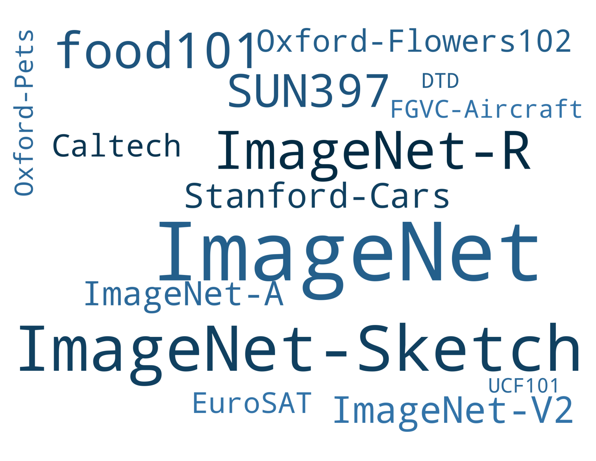

# Plot

Plot is a small collection of Matplotlib helpers for creating publication-ready
line, scatter, bar, histogram, heatmap, radar, box, word-cloud, network, and
Sankey plots.

Plot code heavily borrowed from https://python-graph-gallery.com/

## Documentation & Code 

Start with [Basics](docs/basics.md): how `ALL_PLOT` works, and the options every
plot shares (figure size, colors, ticks, axis limits, grid, label offsets,
reference lines).

| Plot | `plt_type` | Docs | Example code |
| --- | --- | --- | --- |
| Line | `"line"` | [docs/line.md](docs/line.md) | [test_line.py](test_line.py) |
| Bar / histogram | `"bar"` | [docs/hist.md](docs/hist.md) | [test_hist.py](test_hist.py) |
| Heatmap | `"heatmap"` | [docs/heatmap.md](docs/heatmap.md) | [test_heatmap.py](test_heatmap.py) |
| Radar, word cloud | `"radar"`, `"word_cloud"` | [docs/misc.md](docs/misc.md) | [test_misc.py](test_misc.py) |
| Scatter | `"scatter"` | [docs/scatter.md](docs/scatter.md) | [test_scatter.py](test_scatter.py) |


## Sample plots

These plots are generated by the example scripts in the repository:

| Line plot | Scatter plot | Histogram |
| --- | --- | --- |
|  |  |  |
| Heatmap | Word Cloud| Radar |
|  |  |  |
| Network | bubble_plot | sankey_plot |
|  |  | |


## Quick start

```python
from ALL_PLOTS import ALL_PLOT
from colors_set import DISTINCT_3_6

plotter = ALL_PLOT(
    figsize=(6, 6),
    colors=DISTINCT_3_6,
    artificial_darkening=0.8,
)

plotter.plot(
    plt_type="line",
    name="Pictures/Lines/my_line_plot",
    Lines=[
        [[0, 1, 2, 3], [10, 45, 35, 75]],
        [[0, 1, 2, 3], [20, 30, 55, 60]],
    ],
)
```

## Installation

```bash
python -m pip install matplotlib torch numpy pandas
python -m pip install seaborn wordcloud netgraph
```

Run the example scripts from the repository root:

```bash
python test_line.py
python test_scatter.py
python test_hist.py
python test_heatmap.py
python test_misc.py
```
