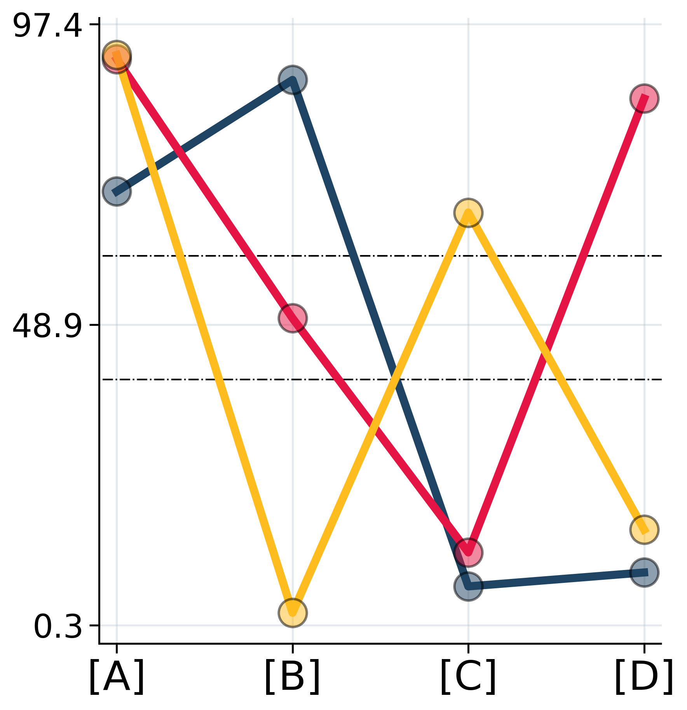
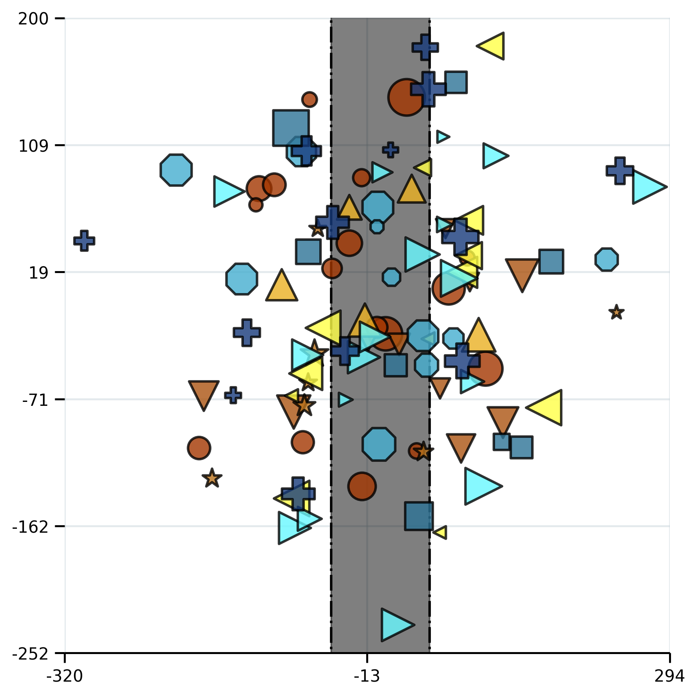
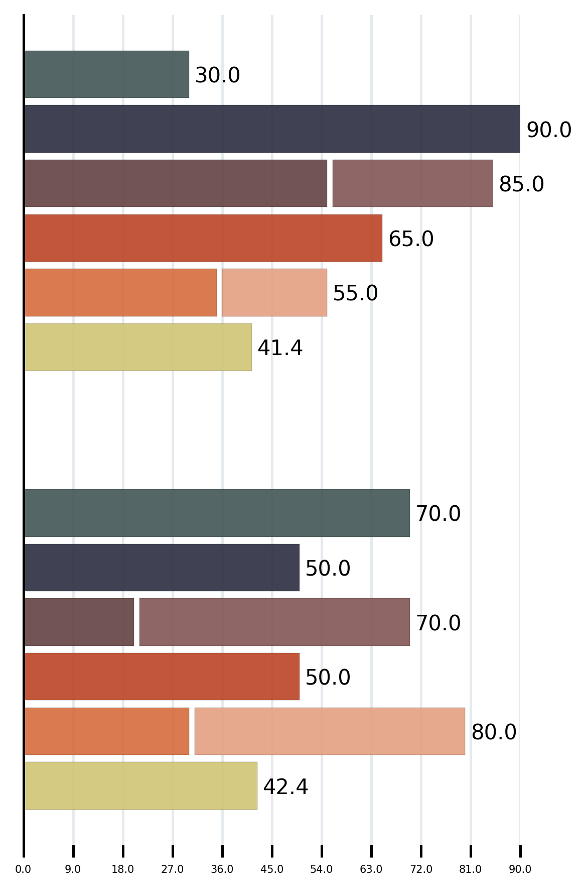
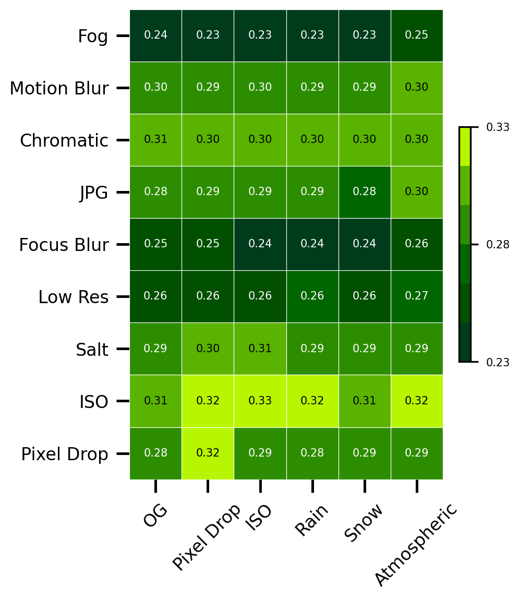

# Plot

Plot is a small collection of Matplotlib helpers for creating publication-ready
line, scatter, bar, histogram, heatmap, radar, box, word-cloud, network, and
Sankey plots.

Plot code heavily borrowed from https://python-graph-gallery.com/

## Documentation & Code 

- [Line plots](docs/line.md) | [Line examples Code](test_line.py)
- [Scatter plots](docs/scatter.md) | [Scatter examples Code](test_scatter.py)
- [Histograms](docs/hist.md) | [Histogram examples Code](test_hist.py)
- [Heatmaps](docs/heatmap.md) | [Heatmap examples Code](test_heatmap.py)


## Sample plots

These plots are generated by the example scripts in the repository:

| Line plot | Scatter plot | Histogram |
| --- | --- | --- |
|  |  |  |
| Heatmap | Word Cloud| |
|  |  | |


## Quick start

```python
from ALL_PLOTS import ALL_PLOT
from colors_set import DISTINCT_3_6

plotter = ALL_PLOT(
    figsize=(6, 6),
    colors=DISTINCT_3_6,
    artificial_darkening=0.8,
)

plotter.plot(
    plt_type="line",
    name="Pictures/Lines/my_line_plot",
    Lines=[
        [[0, 1, 2, 3], [10, 45, 35, 75]],
        [[0, 1, 2, 3], [20, 30, 55, 60]],
    ],
)
```

## Installation

```bash
python -m pip install matplotlib torch numpy
python -m pip install seaborn wordcloud netgraph
```

Run the example scripts from the repository root:

```bash
python test_line.py
python test_scatter.py
python test_hist.py
python test_heatmap.py
```
