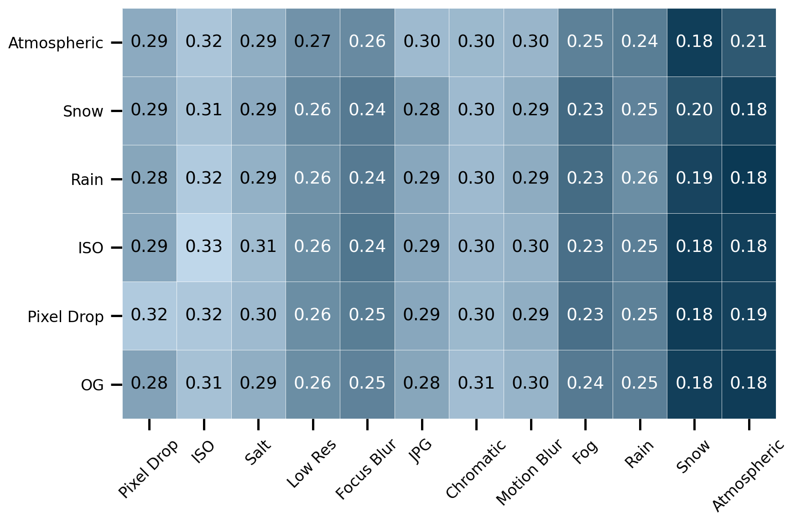
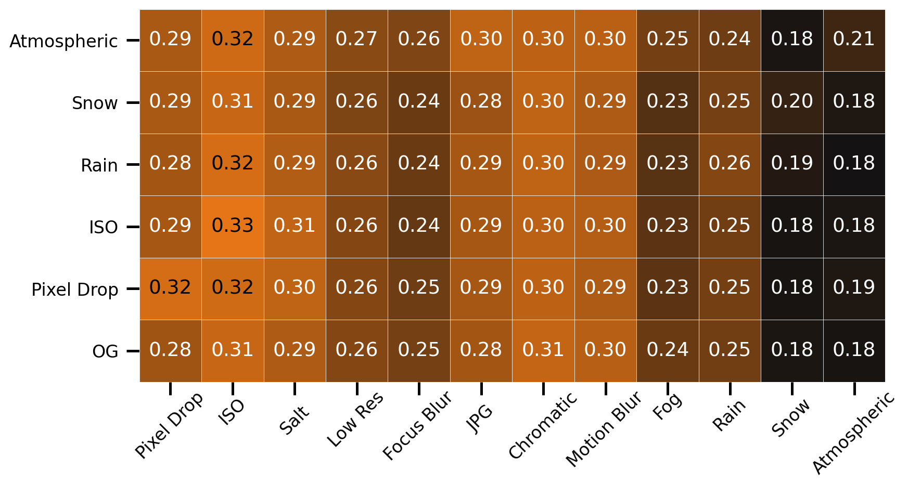
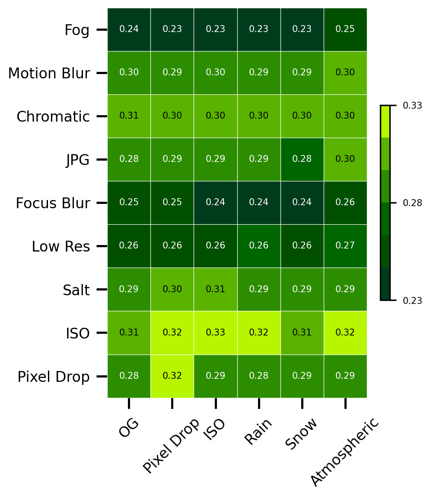
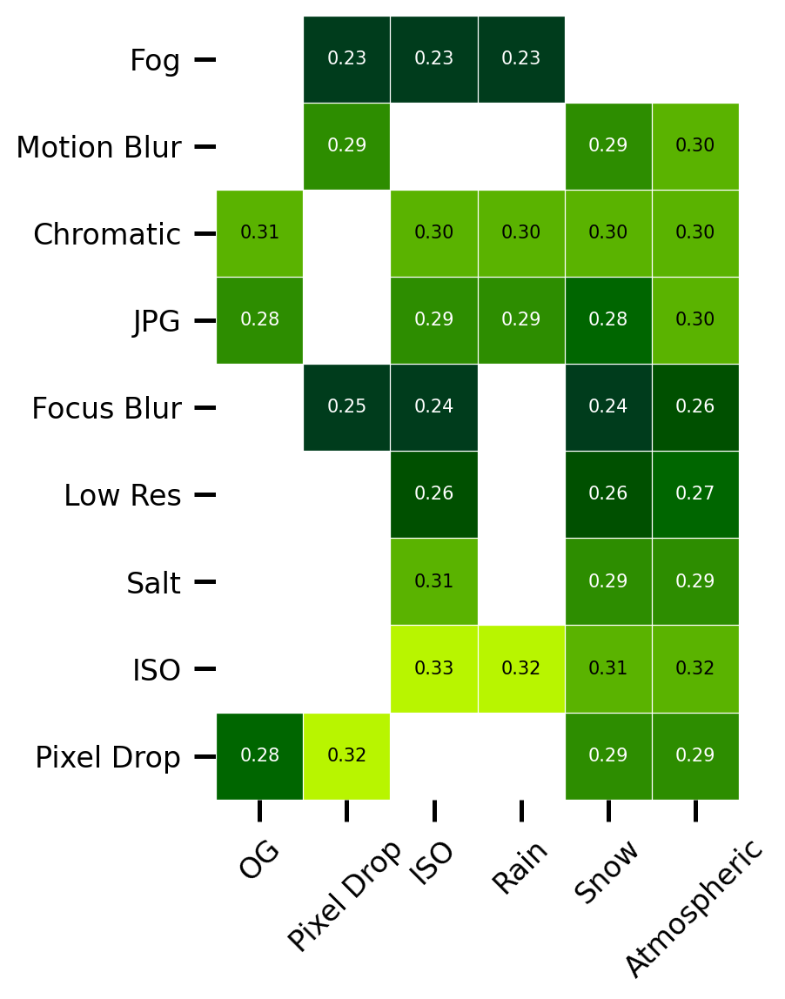

# Heatmaps

`plt_type="heatmap"` draws a colored grid from a pandas DataFrame, with
optional cell values, a colorbar, and hidden cells. Every example below comes
from [`test_heatmap.py`](../test_heatmap.py). For options shared by all plots,
see [basics](basics.md).

Run the examples with:

```bash
python test_heatmap.py
```

## Data format

Pass a DataFrame as `df`. Its **rows** become heatmap rows, labelled with the
index, and its **columns** become heatmap columns, labelled with the column
names. The first row is drawn at the bottom. `NaN` cells are left blank.

The tick positions and labels come from `df`, so `X_range`, `X_labels`,
`Y_range` and `Y_labels` are ignored. The axis-limit offsets and the normal
plot grid are also set by the heatmap. Use the heatmap's own grid options below
instead.

## Setup used by the examples

```python
from ALL_PLOTS import ALL_PLOT
from colors_set import *
import numpy as np
import pandas as pd

PLOT_FN = ALL_PLOT(
    figsize=(6, 4),
    X_label_fontsize=8, X_label_rotate=45,
    Y_label_fontsize=8, Y_label_rotate=0,
    annot=True, annot_decimal_places=2, annot_font_size=9,
    switch_off_yaxis=True, switch_off_xaxis=True,
    colors=DISTINCT_2_7,          # dark blue -> light blue
    artificial_darkening=1,
    grid_shape="xy", grid_color="white", grid_opacity=1, grid_widths=0.2,
    pad_inches=0.06,
)

data = [
    ["OG",          0.28055, 0.31158, 0.29258, 0.26106, 0.24943, 0.28391, 0.30787, 0.29770, 0.24134, 0.24697, 0.18378, 0.18099],
    ["Pixel Drop",  0.32030, 0.31650, 0.30429, 0.26057, 0.24561, 0.28561, 0.30278, 0.29277, 0.23024, 0.24792, 0.18063, 0.18516],
    ["ISO",         0.28526, 0.33376, 0.30581, 0.26062, 0.23708, 0.28597, 0.30110, 0.29686, 0.23022, 0.24723, 0.18088, 0.18308],
    ["Rain",        0.28413, 0.31994, 0.29493, 0.26391, 0.24224, 0.28614, 0.30456, 0.29054, 0.22817, 0.26122, 0.18915, 0.17661],
    ["Snow",        0.28874, 0.31019, 0.28975, 0.25547, 0.24122, 0.27872, 0.30408, 0.29134, 0.22660, 0.24992, 0.20279, 0.18498],
    ["Atmospheric", 0.28827, 0.31609, 0.29267, 0.26541, 0.25755, 0.30398, 0.30282, 0.29951, 0.24740, 0.24463, 0.18213, 0.20890],
]
df = pd.DataFrame(data, columns=[
    "Noise", "Pixel Drop", "ISO", "Salt", "Low Res", "Focus Blur", "JPG",
    "Chromatic", "Motion Blur", "Fog", "Rain", "Snow", "Atmospheric",
])
df.set_index("Noise", inplace=True)   # "Noise" values label the rows
```

## Heatmap options

| Option | Default | What it does |
| --- | --- | --- |
| `df` | required | DataFrame of numbers. |
| `colors` | orange, blue, pink | Two or more colors. They are blended into a gradient from the lowest value (first color) to the highest (last color). |
| `n_bins` | `100` | Number of color steps in the gradient. Small values such as `6` give clearly separated bands. |
| `vmin`, `vmax` | data min / max | Values mapped to the first and last color. |
| `center` | `None` | Value mapped to the middle of the gradient. Useful with three colors for data above and below a baseline. |
| `make_square` | `True` | Make every cell square. `False` lets the figure shape decide. |
| `mask` | `None` | Boolean array with the same shape as `df`. `True` shows a cell, `False` hides it. |
| `annot` | `True` | Write each cell's value inside it. |
| `annot_decimal_places` | `0` | Decimal places in cell values. Also used by colorbar labels. |
| `annot_font_size` | `5` | Cell-value font size. |
| `annot_black_threshold` | `0.3` | Cells darker than this (0 = black, 1 = white) get white text; the rest get black text. |
| `annot_kws` | `None` | Extra Matplotlib text options for cell values, e.g. `{"color": "red", "weight": "bold"}`. A `color` here turns off the automatic black/white choice. |
| `cbar` | `False` | Show a colorbar on the right. |
| `cbar_labels` | `None` | Label the colorbar with values. Without it the colorbar has no ticks. |
| `cbar_count` | `3` | Number of colorbar labels. |
| `cbar_label_fontsize`, `cbar_label_rotate` | `5`, `0` | Colorbar label size and rotation. |
| `cbar_kws` | `{"shrink": 0.5, "pad": 0.03}` | Matplotlib colorbar options: `shrink` sets its height relative to the plot, `pad` its distance from the plot. |
| `grid_shape` | `"both"` | Lines between cells: `"both"`/`"xy"`, `"x"` (between columns), `"y"` (between rows), or `None`. |
| `grid_color`, `grid_opacity`, `grid_widths` | white, `1`, `2` | Color, opacity and thickness of the lines between cells. |

## Annotated heatmap

```python
PLOT_FN.plot(plt_type="heatmap", name="Pictures/Heatmap/test_heatmap",
    df=df,
    make_square=False,
    annot_black_threshold=0.27,
)
```

<p align="center">
  
</p>

## Move x-axis labels

Rotated labels of different lengths can look uneven. `x_axis_label_dist_y`
moves labels up by the given number of inches. Use one number for all labels,
or a dict with one entry per column name:

```python
x_axis_label_dist_y = {
    "Pixel Drop": 0.09, "ISO": 0.05, "Salt": 0,
    "Low Res": 0.09, "Focus Blur": 0.09,
    "JPG": 0, "Chromatic": 0.09,
    "Motion Blur": 0.09, "Fog": 0.09,
    "Rain": 0.05, "Snow": 0.05,
    "Atmospheric": 0.09,
}

PLOT_FN.plot(plt_type="heatmap", name="Pictures/Heatmap/test_heatmap_x_axis_pos",
    df=df,
    colors=DISTINCT_2_1,              # black -> orange
    make_square=True,
    x_axis_label_dist_y=x_axis_label_dist_y,
    artificial_darkening=0.8,
    annot_black_threshold=0.23,
)
```

`x_axis_label_dist_x`, `y_axis_label_dist_x` and `y_axis_label_dist_y` work the
same way. See [basics](basics.md#moving-tick-labels).

<p align="center">
  
</p>

## Colorbar

This example transposes the table, so distortions become rows, and keeps the
first nine rows. A reversed six-step green gradient gives clear color bands:

```python
df = df.T
df = df.iloc[:-3]                     # 9 rows x 6 columns

PLOT_FN.plot(plt_type="heatmap", name="Pictures/Heatmap/test_heatmap_color_bar",
    df=df,
    colors=GRADIENT_GREEN_6[::-1], n_bins=6,
    grid_widths=0.3,
    annot_font_size=5, artificial_darkening=0.8,
    cbar=True, cbar_labels=True,
    figsize=(4, 4),
)
```

<p align="center">
  
</p>

## Hide cells with a mask

`mask` must have the same shape as `df`. `True` shows the cell and `False`
hides it, including its value. Note that this is the opposite of seaborn's
`mask`.

```python
mask = np.array([
    [True,  True,  False, False, True,  True ],
    [False, False, True,  True,  True,  True ],
    [False, False, True,  False, True,  True ],
    [False, False, True,  False, True,  True ],
    [False, True,  True,  False, True,  True ],
    [True,  False, True,  True,  True,  True ],
    [True,  False, True,  True,  True,  True ],
    [False, True,  False, False, True,  True ],
    [False, True,  True,  True,  False, False],
])

PLOT_FN.plot(plt_type="heatmap", name="Pictures/Heatmap/test_heatmap_mask",
    df=df, mask=mask,
    colors=GRADIENT_GREEN_6[::-1], n_bins=6,
    grid_widths=0.3,
    annot_font_size=5, artificial_darkening=0.8,
    figsize=(4, 4),
)
```

<p align="center">
  
</p>

## Common changes

```python
# Diverging colors centred on a baseline value
PLOT_FN.plot(plt_type="heatmap", name="Pictures/Heatmap/my_diverging",
    df=df, colors=[BLUE, "white", RED], center=0.25)

# Fixed color range, no cell values, no lines between cells
PLOT_FN.plot(plt_type="heatmap", name="Pictures/Heatmap/my_plain",
    df=df, vmin=0.15, vmax=0.35, annot=False, grid_shape=None)

# Bold red cell values
PLOT_FN.plot(plt_type="heatmap", name="Pictures/Heatmap/my_bold",
    df=df, annot_kws={"color": "red", "weight": "bold"})
```
