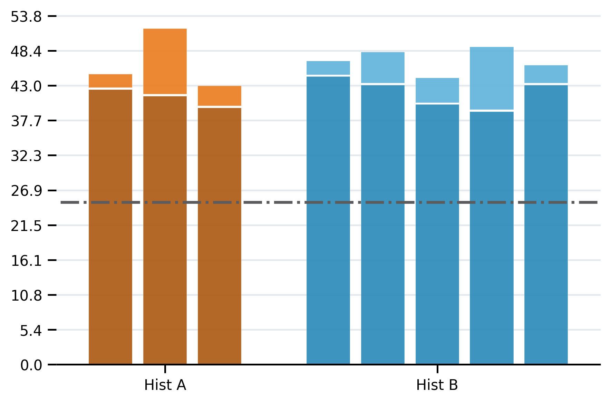
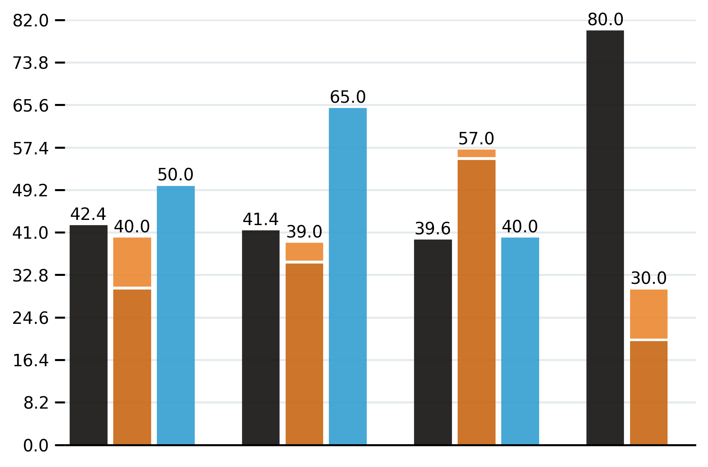
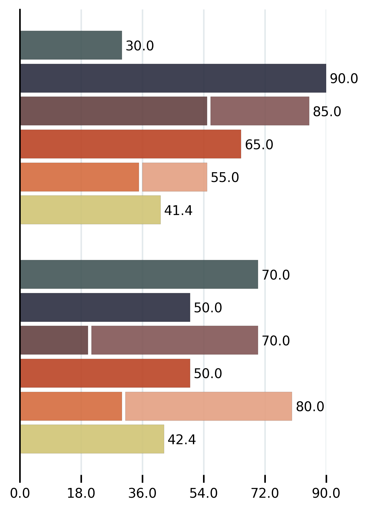

# Bar charts and histograms

`plt_type="bar"` draws grouped bars, stacked bars, hatched bars, horizontal bars,
and histograms of raw data. Every example below comes from
[`test_hist.py`](../test_hist.py). For options shared by all plots (figure size,
ticks, axis limits, grid, label offsets, reference lines), see
[basics](basics.md).

Run the examples with:

```bash
python test_hist.py
```

## Data format

`Hists` is a list of **groups**. Each group is a dict:

```python
{"x": [0, 1, 2],                 # optional: bar positions
 "y": [[42.4, 10, 39.6],         # first series: one height per position
       [ 2.4, 10.4, 3.4]]}       # optional more series, stacked on top
```

- `y` is a list of series. One series gives plain bars. Two or more series
  stack on top of each other at the same positions. Every series in a group
  must have the same length.
- `x` gives the bar positions. Leave `x` out of **every** group and the
  positions are assigned for you: bar *i* of each group sits side by side,
  forming clusters. See [Side-by-side groups](#side-by-side-groups).
- Group *k* uses `colors[k]`. Stacked series in that group use lighter shades
  of the same color.

For raw data you want binned, pass the values instead and set `Hist_mode=True`.
See [Histogram of raw data](#histogram-of-raw-data).

## Setup used by the examples

```python
from ALL_PLOTS import ALL_PLOT
from colors_set import *
import torch

COLORS = DISTINCT_3_1
PLOT_FN = ALL_PLOT(
    figsize=(6, 4),
    colors=COLORS,
    artificial_darkening=0.7,
    automatic_adjust_width=False,
    y_up_offset=2,
    y_axis_pos_offset=2, x_axis_end_limit_offset=3,
    Y_label_fontsize=10, X_label_fontsize=10,
    switch_off_yaxis=True,      # hide the left axis line
    y_points=10,                # 11 y-ticks
    grid_shape="y",             # horizontal grid lines only
)
```

## Bar options

| Option | Default | What it does |
| --- | --- | --- |
| `Hists` | required | List of groups (see above), or raw values with `Hist_mode=True`. |
| `swap_axis` | `False` | Draw horizontal bars. |
| `bar_width` | `0.8` | Bar width in data units. |
| `automatic_adjust_width` | `False` | Make bars as wide as possible without overlapping: smallest gap between positions minus the borders. |
| `bar_border_width` | `0.1` | Border thickness around each bar. Also used as spacing when positions are assigned for you. |
| `bar_border_color` | `"white"` | Border color. |
| `bar_opacity` | `0.9` | Bar opacity. |
| `bar_group_sep` | `1` | Gap between clusters when positions are assigned for you. |
| `stack_dist` | `0.5` | Gap between stacked segments. The segments shrink by this amount so the total height stays the same. |
| `stack_brightness_factor` | `0.3` | How much lighter each stacked segment is than the one below. |
| `Pattern` | `None` | One hatch pattern per group, e.g. `["/", "\\", "x", "o"]`. |
| `bar_labels` | `False` | Write each bar's total height above it. |
| `bar_labels_x_offset`, `bar_labels_y_offset` | `0` | Move the value labels, in data units. |
| `bar_labels_font_size` | `5` | Value-label font size. |
| `bar_labels_color` | green | Value-label color. |
| `bar_label_decimal_places` | `0` | Decimal places in value labels. |
| `bar_connector` | `False` | Draw a line joining the tops of each group's bars. |
| `line_width` | `1` | Width of the connector line and default width of reference lines. |
| `Hist_mode` | `False` | Treat `Hists` as raw values and bin them. |
| `Hist_N_Bins` | `10` | Number of bins with `Hist_mode`. |
| `Hist_gradient` | `False` | Shade each bin by its height using light and dark versions of the color. |
| `Labels` | group index | Legend label per group. Strings need `colors` to be a dict of label → color. |

With `legend=True`, each group gets a legend entry. Without `Labels`, entries
are named `0`, `1`, `2`, ….

## Bars at given positions, with value labels

```python
Hists = [
    {"x": [0, 1, 2],       "y": [[42.4, 10, 39.6]]},
    {"x": [4, 5, 6, 7, 8], "y": [[44.4, 43.1, 30, 39.0, 43.1]]},
]
X_labels = ["Hist A", "Hist B"]
X = [sum(g["x"]) / len(g["x"]) for g in Hists]   # one tick in the middle of each group

PLOT_FN.plot(plt_type="bar", name="Pictures/Hist/test_hist",
    Hists=Hists,
    bar_labels=True, bar_labels_y_offset=1, bar_labels_font_size=10,
    bar_labels_color="black", bar_label_decimal_places=1,
    colors=COLORS[::2],
    legend=True,
    x_axis_end_limit_offset=4,
    X_range=X, X_labels=X_labels,
    automatic_adjust_width=True,
)
```

<p align="center">
  
</p>

## Stacked bars

Add a second series to each group's `y`. Here a reference line at 25 is drawn
on top of the bars (`line_z_oder=50`):

```python
Hists = [
    {"x": [0, 1, 2],       "y": [[42.4, 41.4, 39.6], [2.4, 10.4, 3.4]]},
    {"x": [4, 5, 6, 7, 8], "y": [[44.4, 43.1, 40.1, 39.0, 43.1],
                                 [2.4, 5.1, 4.1, 10.0, 3.1]]},
]

PLOT_FN.plot(plt_type="bar", name="Pictures/Hist/test_hist_stacked",
    Hists=Hists,
    colors=COLORS[1:], artificial_darkening=0.6,
    stack_brightness_factor=0.4, stack_dist=0.3,
    X_range=X, X_labels=X_labels,
    h_lines=[25], hline_color=GREY_DARKER, h_line_width=2, h_line_alpha=1,
    line_z_oder=50,
)
```

<p align="center">
  
</p>

## Side-by-side groups

Leave out `x` and the bars are placed for you: the first bar of every group sits
together in cluster 1, the second bars in cluster 2, and so on. Groups can have
different numbers of bars, and any group can stack.

```python
Hists = [
    {"y": [[42.4, 41.4, 39.6, 80]]},                # group 1: 4 bars
    {"y": [[30, 35, 55, 20], [10, 4, 2, 10]]},      # group 2: 4 stacked bars
    {"y": [[50, 65, 40]]},                          # group 3: 3 bars
]

PLOT_FN.plot(plt_type="bar", name="Pictures/Hist/test_hist_side",
    Hists=Hists,
    colors=COLORS,
    x_axis_end_limit_offset=1, y_axis_pos_offset=0.5,
    automatic_adjust_width=True, bar_border_width=0.06,
    x_ticks_allowed=False,
    bar_labels=True, bar_labels_font_size=10, bar_labels_color="black",
    bar_label_decimal_places=1, bar_labels_y_offset=1,
)
```

<p align="center">
  
</p>

## Hatch patterns

`Pattern` gives each group a hatch. Any Matplotlib hatch works: `/`, `\\`, `|`,
`-`, `+`, `x`, `o`, `O`, `.`, `*`. Repeat a character for denser hatching,
e.g. `"//"`.

```python
Hists = [
    {"y": [[42.4, 41.4]]},
    {"y": [[30, 35], [50, 20]]},
    {"y": [[50, 65]]},
    {"y": [[20, 55], [50, 30]]},
    {"y": [[10, 60]]},
    {"y": [[40, 10]]},
    {"y": [[50, 90]]},
    {"y": [[70, 30]]},
]
PATTERN = ["/", "\\", "-", "x", "o", "O", ".", "*"]

PLOT_FN.plot(plt_type="bar", name="Pictures/Hist/test_hist_pattern",
    Hists=Hists, bar_border_color="black",
    stack_dist=1, bar_group_sep=2,
    colors=GRADIENT_9, Pattern=PATTERN,
    automatic_adjust_width=True, bar_border_width=0.06,
    x_ticks_allowed=False, x_axis_end_limit_offset=1, y_axis_pos_offset=1,
    decimal_places=0,
)
```

<p align="center">
  
</p>

## Histogram of raw data

With `Hist_mode=True`, `Hists` is a list, array or tensor of raw values, and
`Hist_N_Bins` sets the bin count. Pass a single color.

```python
torch.manual_seed(100)
POINTS = torch.randn(10000)

PLOT_FN.plot(plt_type="bar", name="Pictures/Hist/test_hist_binning",
    Hists=POINTS, Hist_mode=True, Hist_N_Bins=50,
    colors=BLUE,
    Hist_gradient=True,                 # taller bins are drawn darker
    automatic_adjust_width=True, bar_border_width=0.01,
    y_points=10, x_points=10, decimal_places=0,
    y_axis_pos_offset=0.1, x_axis_end_limit_offset=0.01, y_up_offset=100,
)
```

<p align="center">
  
</p>

## Horizontal bars

`swap_axis=True` turns the bars sideways. Bar values now run along the x-axis,
so the test moves the grid, axis lines and offsets with `update()` first:

```python
Hists = [
    {"y": [[42.4, 41.4]]},
    {"y": [[30, 35], [50, 20]]},
    {"y": [[50, 65]]},
    {"y": [[20, 55], [50, 30]]},
    {"y": [[50, 90]]},
    {"y": [[70, 30]]},
]

PLOT_FN.update(dict(
    figsize=(4, 5.5),
    X_label_fontsize=10,
    grid_shape="x",                         # vertical grid lines
    switch_off_yaxis=False, switch_off_xaxis=True,
    x_points=5,
    y_up_offset=0,
    y_axis_pos_offset=0,
    x_axis_end_limit_offset=0,
    x_axis_pos_offset=1,
    y_axis_end_limit_offset=1,
    colors=GRADIENT_9,
    y_ticks_allowed=False,
))

PLOT_FN.plot(plt_type="bar", name="Pictures/Hist/test_hist_swap",
    Hists=Hists, bar_border_color="black", swap_axis=True,
    stack_dist=1, bar_group_sep=1,
    automatic_adjust_width=True, bar_border_width=0.06,
    bar_labels=True, bar_labels_font_size=10, bar_labels_color="black",
    bar_label_decimal_places=1,
    bar_labels_x_offset=1,                  # value labels sit 1 unit right of the bar
)
```

A band along the value axis uses `v_line_shade`. `v_line_alpha=0` hides its
edge lines:

```python
PLOT_FN.plot(plt_type="bar", name="Pictures/Hist/test_hist_hshade",
    Hists=Hists, bar_border_color="black", swap_axis=True, bar_opacity=1,
    stack_dist=1, bar_group_sep=2,
    automatic_adjust_width=True, bar_border_width=0.06,
    v_line_shade=[[45, 72]], v_line_shade_color=GREEN,
    v_line_shade_color_alpha=0.3, v_line_alpha=0,
)
```

<p align="center">
  
  
</p>

## Common changes

```python
# Named legend entries: use a dict of label -> color
PLOT_FN.plot(plt_type="bar", name="Pictures/Hist/my_named",
    Hists=[{"x": [0, 1], "y": [[3, 5]]}, {"x": [3, 4], "y": [[4, 2]]}],
    Labels=["Model A", "Model B"],
    colors={"Model A": BLUE, "Model B": ORANGE},
    legend=True)

# Line joining the bar tops of each group
PLOT_FN.plot(plt_type="bar", name="Pictures/Hist/my_connected",
    Hists=Hists, bar_connector=True, line_width=2)
```
