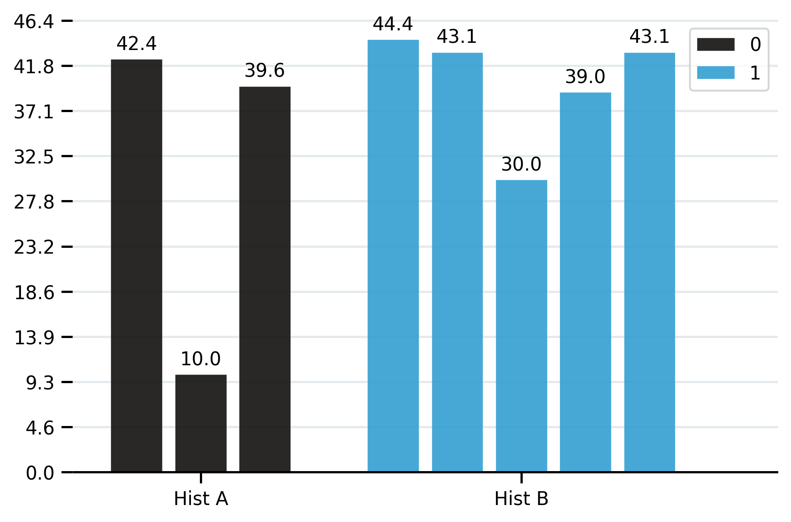
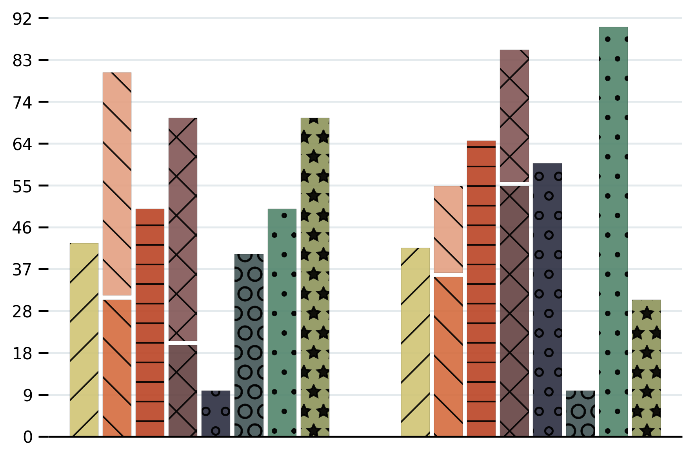
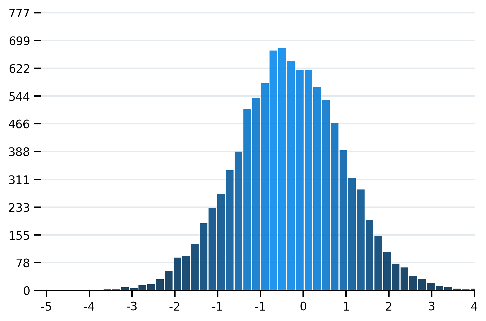
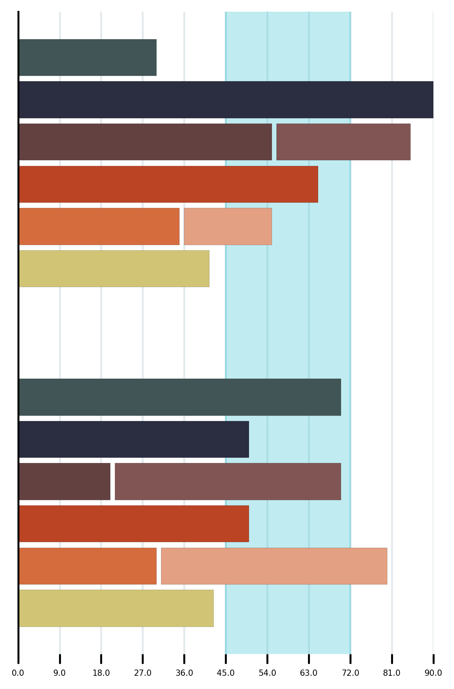

# Histograms

These examples follow [`test_hist.py`](../test_hist.py). The test calls
`ALL_PLOT.plot` with `plt_type="bar"` for both pre-computed bar values and
histograms made from raw data. Pre-computed input uses a list of dictionaries:
each dictionary can provide `x` positions and one or more `y` series.

## Setup

The test uses `DISTINCT_3_1` colors and configures a y-axis grid:

```python
from ALL_PLOTS import ALL_PLOT
from colors_set import (
    BLUE,
    DISTINCT_3_1,
    GRADIENT_9,
    GREEN,
    GREY_DARKER,
)

Hist_config = dict(
    artificial_darkening=0.7,
    automatic_adjust_width=False,
)

COLORS = DISTINCT_3_1
PLOT_FN = ALL_PLOT(
    figsize=(6, 4),
    colors=COLORS,
    y_up_offset=2,
    y_axis_pos_offset=2,
    x_axis_end_limit_offset=3,
    Y_label_fontsize=10,
    X_label_fontsize=10,
    switch_off_yaxis=True,
    y_points=10,
    grid_shape="y",
    **Hist_config,
)
```

## Predefined bar positions and value labels

`Hists` below has two groups. Each entry contains x coordinates and one y
series; `X_range` and `X_labels` provide a center position and a label for each
group. `bar_labels=True` prints the bar values:

```python
Hists = [
    {"x": [0, 1, 2], "y": [[42.4, 10, 39.6]]},
    {"x": [4, 5, 6, 7, 8], "y": [[44.4, 43.1, 30, 39.0, 43.1]]},
]
X_labels = ["Hist A", "Hist B"]
X = [sum(e["x"]) / len(e["x"]) for e in Hists]

PLOT_FN.plot(
    plt_type="bar",
    name="Pictures/Hist/test_hist",
    Hists=Hists,
    bar_labels=True,
    bar_labels_y_offset=1,
    bar_labels_font_size=10,
    bar_labels_color="black",
    bar_label_decimal_places=1,
    colors=COLORS[::2],
    legend=True,
    x_axis_end_limit_offset=4,
    X_range=X,
    X_labels=X_labels,
    automatic_adjust_width=True,
)
```

<p align="center">
  
</p>

## Stacked values

Add a second y-series to each group to stack values. `stack_dist` controls
spacing between stacked sections, and `h_lines` adds a horizontal reference:

```python
Hists = [
    {"x": [0, 1, 2], "y": [[42.4, 41.4, 39.6], [2.4, 10.4, 3.4]]},
    {"x": [4, 5, 6, 7, 8],
     "y": [[44.4, 43.1, 40.1, 39.0, 43.1], [2.4, 5.1, 4.1, 10.0, 3.1]]},
]

PLOT_FN.plot(
    plt_type="bar",
    name="Pictures/Hist/test_hist_stacked",
    Hists=Hists,
    colors=COLORS[1:],
    artificial_darkening=0.6,
    stack_brightness_factor=0.4,
    stack_dist=0.3,
    X_range=X,
    X_labels=X_labels,
    h_lines=[25],
    hline_color=GREY_DARKER,
    h_line_width=2,
    h_line_alpha=1,
    line_z_oder=50,
)
```

<p align="center">
  
</p>

## Side-by-side groups

When `x` is omitted, the plot helper assigns bar positions. Multiple series can
be supplied as separate lists in `y`:

```python
Hists = [
    {"y": [[42.4, 41.4, 39.6, 80]]},
    {"y": [[30, 35, 55, 20], [10, 4, 2, 10]]},
    {"y": [[50, 65, 40]]},
]

PLOT_FN.plot(
    plt_type="bar",
    name="Pictures/Hist/test_hist_side",
    Hists=Hists,
    colors=COLORS,
    x_axis_end_limit_offset=1,
    y_axis_pos_offset=0.5,
    automatic_adjust_width=True,
    bar_border_width=0.06,
    x_ticks_allowed=False,
    bar_labels=True,
    bar_labels_font_size=10,
    bar_labels_color="black",
    bar_label_decimal_places=1,
    bar_labels_y_offset=1,
)
```

<p align="center">
  
</p>

## Bar patterns

`Pattern` assigns hatch patterns to the series. The example uses eight groups,
as in the test:

```python
Hists = [
    {"y": [[42.4, 41.4]]},
    {"y": [[30, 35], [50, 20]]},
    {"y": [[50, 65]]},
    {"y": [[20, 55], [50, 30]]},
    {"y": [[10, 60]]},
    {"y": [[40, 10]]},
    {"y": [[50, 90]]},
    {"y": [[70, 30]]},
]
PATTERN = ["/", "\\", "-", "x", "o", "O", ".", "*"]

PLOT_FN.plot(
    plt_type="bar",
    name="Pictures/Hist/test_hist_pattern",
    Hists=Hists,
    bar_border_color="black",
    stack_dist=1,
    bar_group_sep=2,
    colors=GRADIENT_9,
    Pattern=PATTERN,
    automatic_adjust_width=True,
    bar_border_width=0.06,
    x_ticks_allowed=False,
    x_axis_end_limit_offset=1,
    y_axis_pos_offset=1,
    decimal_places=0,
)
```

<p align="center">
  
</p>

## Bin raw data

Set `Hist_mode=True` to pass raw values rather than pre-binned bars.
`Hist_N_Bins` controls the number of bins. The test seeds PyTorch before
generating 10,000 normal random values:

```python
import torch

torch.manual_seed(100)
torch.cuda.manual_seed_all(100)
N_POINTS = 10000
POINTS = torch.randn(N_POINTS)
N_BINS = 50

PLOT_FN.plot(
    plt_type="bar",
    name="Pictures/Hist/test_hist_binning",
    Hists=POINTS,
    Hist_mode=True,
    Hist_N_Bins=N_BINS,
    colors=BLUE,
    automatic_adjust_width=True,
    y_points=10,
    x_points=10,
    decimal_places=0,
    y_axis_pos_offset=0.1,
    x_axis_end_limit_offset=0.01,
    y_up_offset=100,
    bar_border_width=0.01,
    Hist_gradient=True,
)
```

<p align="center">
  
</p>

## Swapped axes and shaded values

For horizontal bars, set `swap_axis=True`. The test updates the plotter's
dimensions and axis settings, then supplies six groups:

```python
Hists = [
    {"y": [[42.4, 41.4]]},
    {"y": [[30, 35], [50, 20]]},
    {"y": [[50, 65]]},
    {"y": [[20, 55], [50, 30]]},
    {"y": [[50, 90]]},
    {"y": [[70, 30]]},
]

PLOT_FN.update(dict(
    figsize=(4, 6),
    X_label_fontsize=5,
    grid_shape="x",
    switch_off_yaxis=False,
    switch_off_xaxis=True,
    x_points=10,
    y_up_offset=0,
    y_axis_pos_offset=0,
    x_axis_end_limit_offset=0,
    x_axis_pos_offset=1,
    y_axis_end_limit_offset=1,
    colors=GRADIENT_9,
    y_ticks_allowed=False,
))

PLOT_FN.plot(
    plt_type="bar",
    name="Pictures/Hist/test_hist_swap",
    Hists=Hists,
    bar_border_color="black",
    swap_axis=True,
    stack_dist=1,
    bar_group_sep=2,
    automatic_adjust_width=True,
    bar_border_width=0.06,
    bar_labels=True,
    bar_labels_font_size=10,
    bar_labels_color="black",
    bar_label_decimal_places=1,
    bar_labels_x_offset=1,
)
```

The same horizontal bars can show a shaded value range with `v_line_shade`:

```python
PLOT_FN.plot(
    plt_type="bar",
    name="Pictures/Hist/test_hist_hshade",
    Hists=Hists,
    bar_border_color="black",
    swap_axis=True,
    bar_opacity=1,
    stack_dist=1,
    bar_group_sep=2,
    automatic_adjust_width=True,
    bar_border_width=0.06,
    v_line_shade=[[45, 72]],
    v_line_shade_color=GREEN,
    v_line_shade_color_alpha=0.3,
    v_line_alpha=0,
)
```

<p align="center">
  
  
</p>
