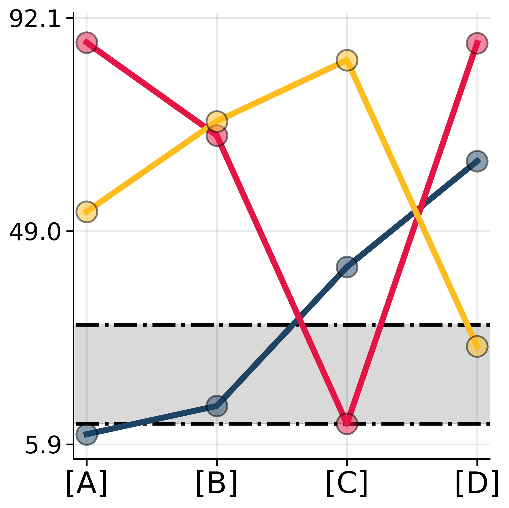
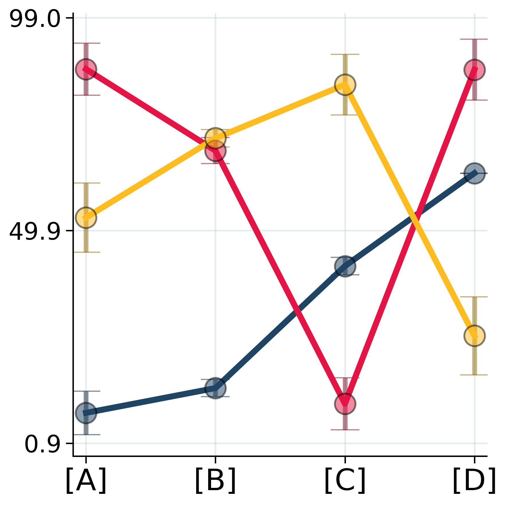
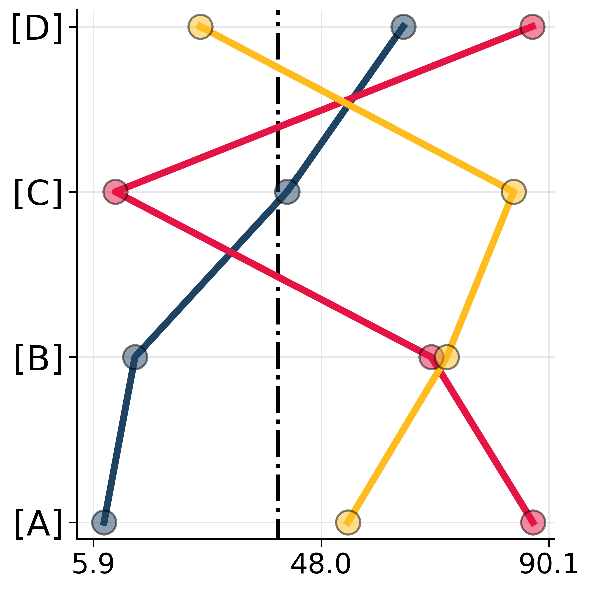
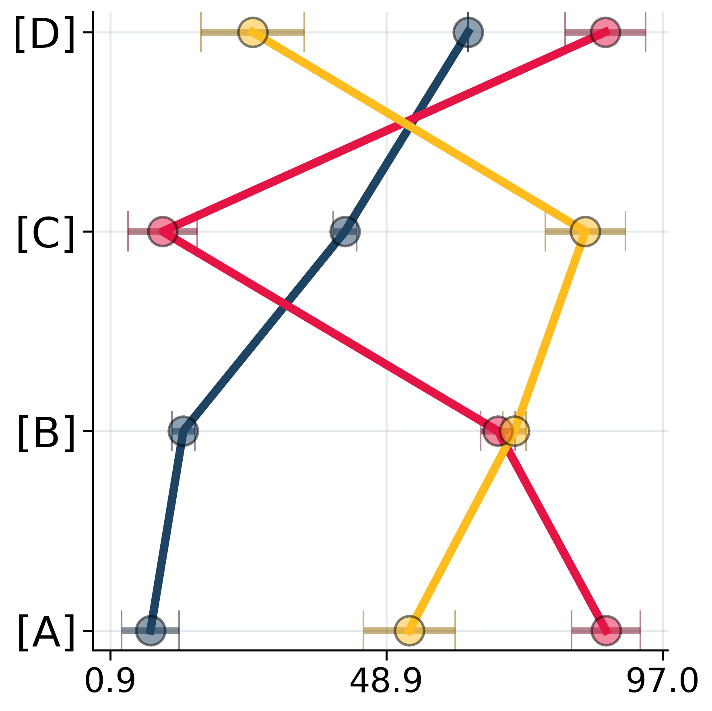

# Line plots

These examples correspond to [`test_line.py`](../test_line.py). The class-based
[`ALL_PLOT`](../ALL_PLOTS.py) interface combines line drawing, axis styling,
colors, labels, and image saving.

## Basic multiple-line plot

```python
from ALL_PLOTS import ALL_PLOT
from colors_set import DISTINCT_3_6
import torch

Line_config = dict(
    line_width=5,
    alpha_line=1,
    use_scatter=True,
    scatter_size=300,
    scatter_boder_color="black",
    scatter_alpha=0.5,
)

PLOT_FN = ALL_PLOT(
    figsize=(6, 6),
    colors=DISTINCT_3_6,
    decimal_places=1,
    y_up_offset=5,
    y_down_offset=2,
    x_up_offset=3,
    x_down_offset=2,
    y_axis_end_limit_offset=1,
    x_axis_pos_offset=3,
    y_axis_pos_offset=0.1,
    **Line_config,
)

X = [0, 1, 2, 3]
X_labels = ["[A]", "[B]", "[C]", "[D]"]
Lines = [[X, torch.rand(4) * 100] for _ in range(3)]

PLOT_FN.plot(
    plt_type="line",
    name="Pictures/Lines/test_lines",
    Lines=Lines,
    h_lines=[40, 60], hline_color="black", h_line_width=1,
    X_range=X,
    X_labels=X_labels,
)
```

<p align="center">
  
</p>

This follows the setup in `test_line.py`: three lines use random y-values,
scatter markers are enabled in `Line_config`, and `h_lines` adds horizontal
guides at 40 and 60. The random values mean each run can look different.

## Reference lines and shaded regions

[`plot_add.py`](../plot_add.py) supplies shared annotations for line and scatter
plots:

| Feature | Arguments |
| --- | --- |
| Horizontal guide line | `h_lines=[40, 60], hline_color="black"` |
| Vertical guide line | `v_lines=[40], vline_color="black"` |
| Horizontal shaded region | `h_line_shade=[[40, 60]], h_line_shade_color="black"` |
| Vertical shaded region | `v_line_shade=[[1, 2.2]], v_line_shade_color="black"` |
| Scatter markers | `use_scatter=True, scatter_size=300, scatter_boder_color="black"` |
| Swapped axes | `swap_axis=True, Y_range=X, Y_labels=X_labels` |

Horizontal shading and vertical shading are separate annotations. The following
example applies a vertical band to the x-axis:

```python
PLOT_FN.plot(
    plt_type="line",
    name="Pictures/Lines/test_lines_v_shade",
    Lines=Lines,
    X_range=X,
    X_labels=X_labels,
    v_line_shade=[[1, 2.2]],
    v_line_shade_color="black",
    v_line_shade_color_alpha=0.15,
)
```

<p align="center">
  
</p>

For a band on the y-axis, use `h_line_shade`:

```python
PLOT_FN.plot(
    plt_type="line",
    name="Pictures/Lines/test_lines_h_shade",
    Lines=Lines,
    X_range=X,
    X_labels=X_labels,
    h_line_shade=[[10, 30]],
    h_line_shade_color="black",
    h_line_shade_color_alpha=0.15,
)
```

<p align="center">
  
</p>

## Uncertainty bands

Use `shade_up` and `shade_down` to draw one filled range around each line:

```python
Shades_MAX = [(e[0], e[1] + torch.randint(20, (4,))) for e in Lines]
Shades_MIN = [(e[0], e[1] - torch.randint(20, (4,))) for e in Lines]

PLOT_FN.plot(
    plt_type="line",
    name="Pictures/Lines/test_lines_shade",
    Lines=Lines,
    shade=True,
    shade_up=Shades_MAX,
    shade_down=Shades_MIN,
)
```

<p align="center">
  
</p>

## Error bars

Error bars use paired X/Y data and one standard-deviation value per point:

```python
STD = [(e[0], torch.randint(10, (4,))) for e in Lines]

PLOT_FN.plot(
    plt_type="line",
    name="Pictures/Lines/test_lines_error",
    Lines=Lines,
    error_bar=True,
    error_std=STD,
    error_bar_color=None,
    error_bar_width=4,
)
```

<p align="center">
  
</p>

## Swapped axes

The same line, band, and error-bar logic can swap X and Y values:

```python
PLOT_FN.update(dict(
    x_axis_pos_offset=0.1,
    y_axis_pos_offset=3,
    Y_label_fontsize=25,
    X_label_fontsize=20,
    x_axis_end_limit_offset=1,
    y_axis_end_limit_offset=0.1,
))

PLOT_FN.plot(
    plt_type="line",
    name="Pictures/Lines/test_lines_axis_swap",
    Lines=Lines,
    v_lines=[40], vline_color="black", v_line_width=3,
    Y_range=X, Y_labels=X_labels,
    swap_axis=True,
)
```

<p align="center">
  
</p>

The uncertainty-band and error-bar sections can also be swapped:

<p align="center">
  
  
</p>

## Colors

Use named colors or palettes from [`colors_set.py`](../colors_set.py):

```python
from colors_set import DISTINCT_3_6

plotter = ALL_PLOT(
    colors=DISTINCT_3_6,
    artificial_darkening=0.8,
)
```
