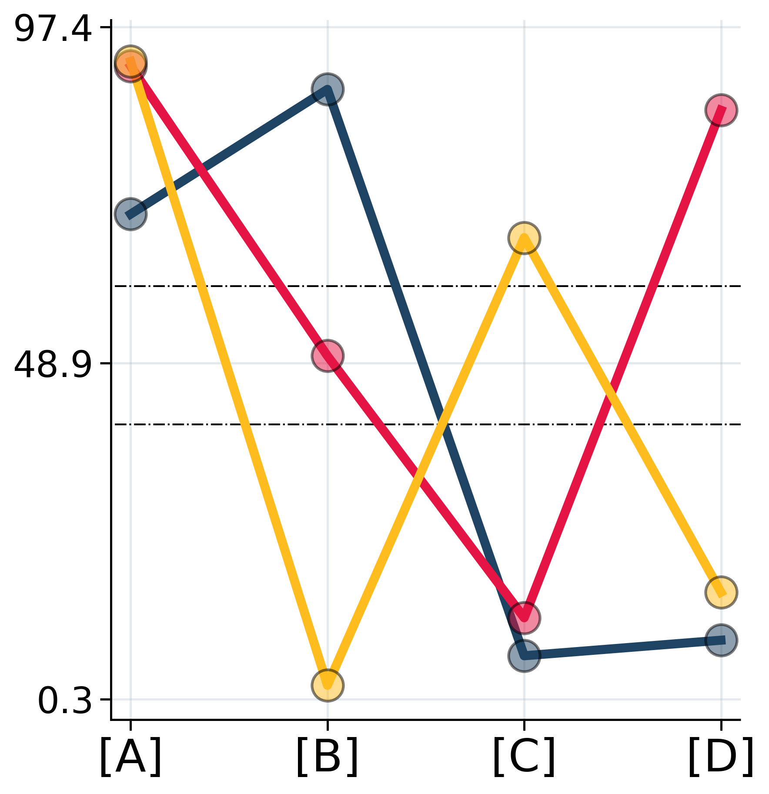
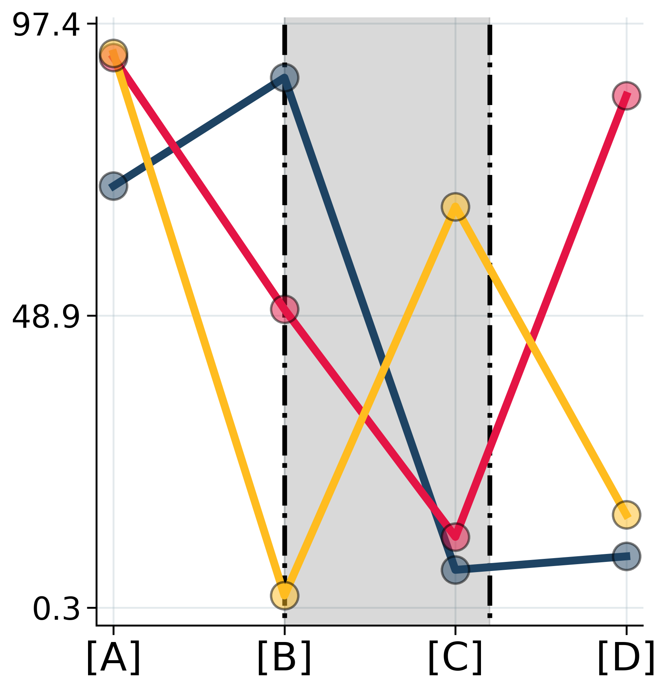
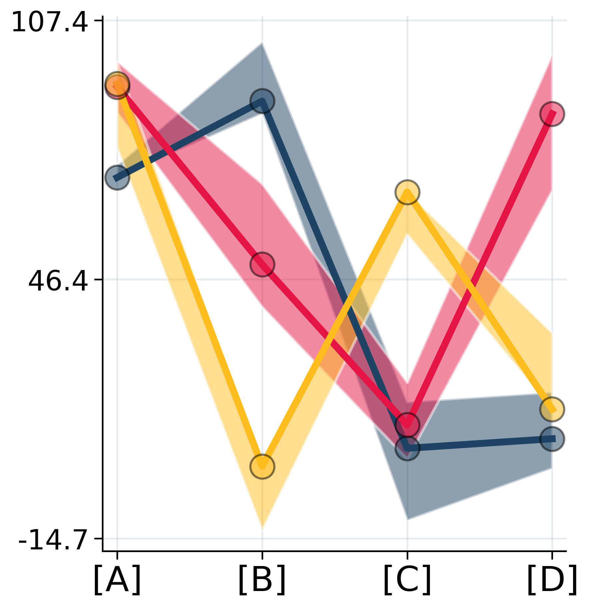
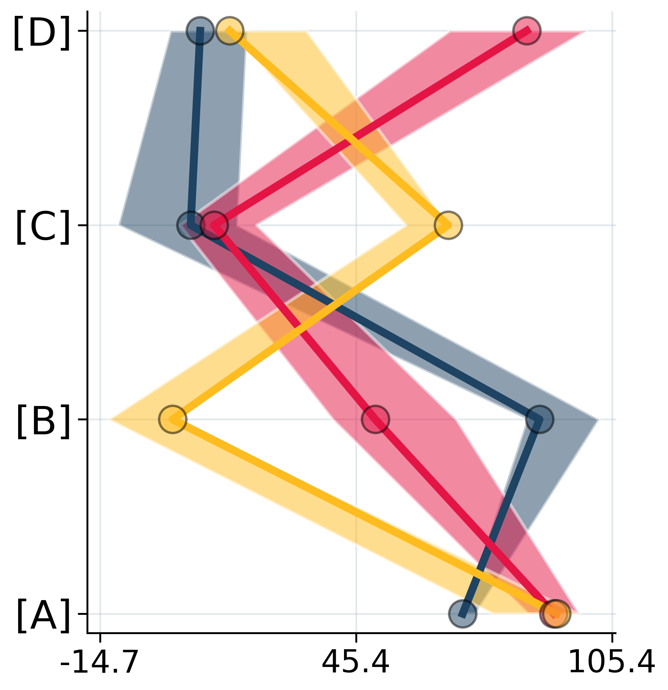

# Line plots

`plt_type="line"` draws one or more lines, with optional point markers,
uncertainty bands, error bars, reference lines and shaded regions. Every example
below comes from [`test_line.py`](../test_line.py). For options shared by all
plots (figure size, ticks, axis limits, grid, label offsets), see
[basics](basics.md).

Run the examples with:

```bash
python test_line.py
```

The test data is random (`torch.rand`), so your images will differ from the
ones shown here.

## Data format

`Lines` is a list with one `[X, Y]` pair per line. `X` and `Y` must have the
same length. They can be Python lists or 1-D tensors.

```python
X = [0, 1, 2, 3]
Lines = [
    [X, [10, 45, 35, 75]],   # line 1
    [X, [20, 30, 55, 60]],   # line 2
]
```

Line *i* uses `colors[i]`, so `colors` needs at least as many entries as
`Lines`.

## Setup used by the examples

```python
from ALL_PLOTS import ALL_PLOT
from colors_set import *
import torch

Line_config = dict(
    line_width=5, alpha_line=1,
    use_scatter=True, scatter_size=300,
    scatter_boder_color="black", scatter_alpha=0.5,
)

PLOT_FN = ALL_PLOT(
    figsize=(6, 6.2),
    colors=DISTINCT_3_6,
    decimal_places=1,
    y_up_offset=5, y_down_offset=2,     # y-ticks run 2 below the data to 5 above it
    x_up_offset=3, x_down_offset=2,
    y_axis_end_limit_offset=1,          # 1 unit of space above the last y-tick
    x_axis_pos_offset=3,                # x-axis sits 3 units below the first y-tick
    y_axis_pos_offset=0.1,
    **Line_config,                      # line options shared by every call
)

X = [0, 1, 2, 3]
X_labels = ["[A]", "[B]", "[C]", "[D]"]
Lines = [[X, torch.rand(4) * 100] for _ in range(3)]
```

## Line options

| Option | Default | What it does |
| --- | --- | --- |
| `Lines` | required | List of `[X, Y]` pairs, one per line. |
| `line_width` | `5` | Line thickness. Also the default width of reference lines. |
| `alpha_line` | `1` | Line opacity, `0` to `1`. |
| `use_scatter` | `True` | Draw a marker at each data point. |
| `scatter_size` | `50` | Marker area. |
| `scatter_boder` | `1.5` | Marker edge thickness. |
| `scatter_boder_color` | `None` | Marker edge color. `None` uses the line color. |
| `scatter_alpha` | `1` | Marker opacity. |
| `swap_axis` | `False` | Draw the data in `Lines` with x and y swapped. See [Swapped axes](#swapped-axes). |
| `shade`, `shade_up`, `shade_down` | off | Uncertainty band per line. See [Uncertainty bands](#uncertainty-bands). |
| `shade_alpha` | `0.5` | Band opacity. |
| `shade_line_width` | `2` | Width of the white edge around each band. |
| `shade_darkening` | `1` | Lightness multiplier for band colors (below `1` darkens). |
| `error_bar`, `error_std` | off | Error bars per line. See [Error bars](#error-bars). |
| `error_bar_color` | `"black"` | One color for all error bars. `None` uses each line's own color. |
| `error_darkening` | `0.5` | Lightness multiplier for error-bar colors. |
| `error_bar_width` | `1` | Error-bar thickness. |
| `error_alpha` | `0.5` | Error-bar opacity. |

Reference lines and shaded regions (`h_lines`, `v_lines`, `h_line_shade`,
`v_line_shade` and their styling) are listed in
[basics](basics.md#reference-lines-and-shaded-bands).

## Basic plot with reference lines

```python
PLOT_FN.plot(plt_type="line", name="Pictures/Lines/test_lines",
    Lines=Lines,
    h_lines=[40, 60], hline_color="black", h_line_width=1,
    X_range=X, X_labels=X_labels,
)
```

`X_range` and `X_labels` replace the automatic x-ticks with the four named
positions. The y-ticks are still automatic. `h_lines` draws thin black
dash-dot lines at y = 40 and y = 60.

<p align="center">
  
</p>

## Shaded regions

A horizontal band marks a y-range:

```python
PLOT_FN.plot(plt_type="line", name="Pictures/Lines/test_lines_h_shade",
    Lines=Lines,
    X_range=X, X_labels=X_labels,
    h_line_shade=[[10, 30]], h_line_shade_color="black",
    h_line_shade_color_alpha=0.15, h_line_width=3,
)
```

A vertical band marks an x-range:

```python
PLOT_FN.plot(plt_type="line", name="Pictures/Lines/test_lines_v_shade",
    Lines=Lines,
    X_range=X, X_labels=X_labels,
    v_line_shade=[[1, 2.2]], v_line_shade_color="black",
    v_line_shade_color_alpha=0.15, v_line_width=3,
)
```

Pass more pairs for more bands, e.g. `h_line_shade=[[10, 30], [70, 90]]`, and a
list of colors to color them separately.

<p align="center">
  
  
</p>

## Uncertainty bands

`shade_up` and `shade_down` each hold one `(X, Y_bound)` pair per line, in the
same order as `Lines`. The `X` must match the line's `X`.

```python
Shades_MAX = [(x, y + torch.randint(20, (4,))) for x, y in Lines]
Shades_MIN = [(x, y - torch.randint(20, (4,))) for x, y in Lines]

PLOT_FN.plot(plt_type="line", name="Pictures/Lines/test_lines_shade",
    Lines=Lines,
    X_range=X, X_labels=X_labels,
    shade=True, shade_up=Shades_MAX, shade_down=Shades_MIN,
)
```

<p align="center">
  
</p>

## Error bars

`error_std` holds one `(X, std)` pair per line. Each bar spans `Y - std` to
`Y + std`.

```python
STD = [(x, torch.randint(10, (4,))) for x, _ in Lines]

PLOT_FN.plot(plt_type="line", name="Pictures/Lines/test_lines_error",
    Lines=Lines,
    X_range=X, X_labels=X_labels,
    error_bar=True, error_std=STD,
    error_bar_color=None,      # use each line's color
    error_bar_width=4,
)
```

<p align="center">
  
</p>

## Swapped axes

`swap_axis=True` draws the lines vertically, with the old x-values on the
y-axis. Keep `Lines` the same and move the tick settings to the y-axis
(`Y_range`, `Y_labels`). The axis-limit offsets usually need swapping too, so
the test changes them once with `update()`:

```python
PLOT_FN.update(dict(
    x_axis_pos_offset=0.1,
    y_axis_pos_offset=3,
    Y_label_fontsize=25,
    X_label_fontsize=20,
    x_axis_end_limit_offset=1,
    y_axis_end_limit_offset=0.1,
))

PLOT_FN.plot(plt_type="line", name="Pictures/Lines/test_lines_axis_swap",
    Lines=Lines,
    v_lines=[40], vline_color="black", v_line_width=3,
    Y_range=X, Y_labels=X_labels, swap_axis=True,
)
```

Reference lines are not swapped for you. After swapping, a value threshold is a
vertical line, so the example uses `v_lines` instead of `h_lines`.

Bands and error bars work the same way when swapped:

```python
PLOT_FN.plot(plt_type="line", name="Pictures/Lines/test_lines_shade_swap",
    Lines=Lines,
    shade=True, shade_up=Shades_MAX, shade_down=Shades_MIN,
    Y_range=X, Y_labels=X_labels, swap_axis=True,
)

PLOT_FN.plot(plt_type="line", name="Pictures/Lines/test_lines_error_swap",
    Lines=Lines,
    error_bar=True, error_std=STD, error_bar_color=None, error_bar_width=4,
    Y_range=X, Y_labels=X_labels, swap_axis=True,
)
```

<p align="center">
  
  
  
</p>

## Common changes

```python
# Thin lines without markers
PLOT_FN.plot(plt_type="line", name="Pictures/Lines/my_plain", Lines=Lines,
    line_width=2, use_scatter=False)

# More y-ticks with no decimals
PLOT_FN.plot(plt_type="line", name="Pictures/Lines/my_ticks", Lines=Lines,
    y_points=5, decimal_places=0)

# Only horizontal grid lines, no left axis line
PLOT_FN.plot(plt_type="line", name="Pictures/Lines/my_clean", Lines=Lines,
    grid_shape="y", switch_off_yaxis=True)
```
