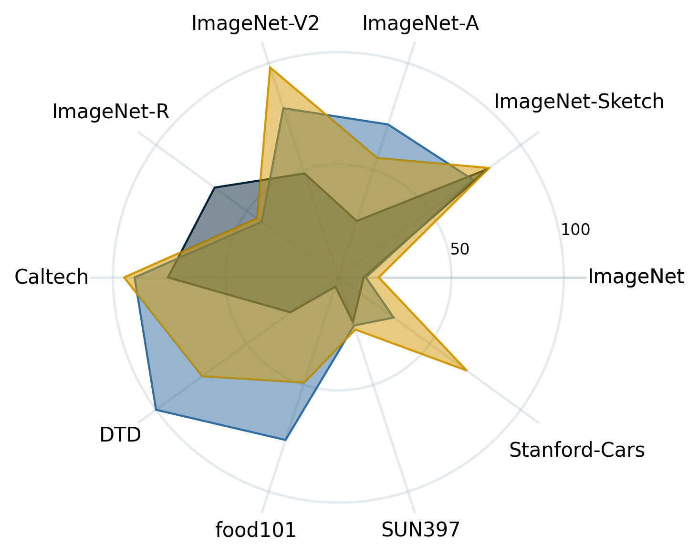
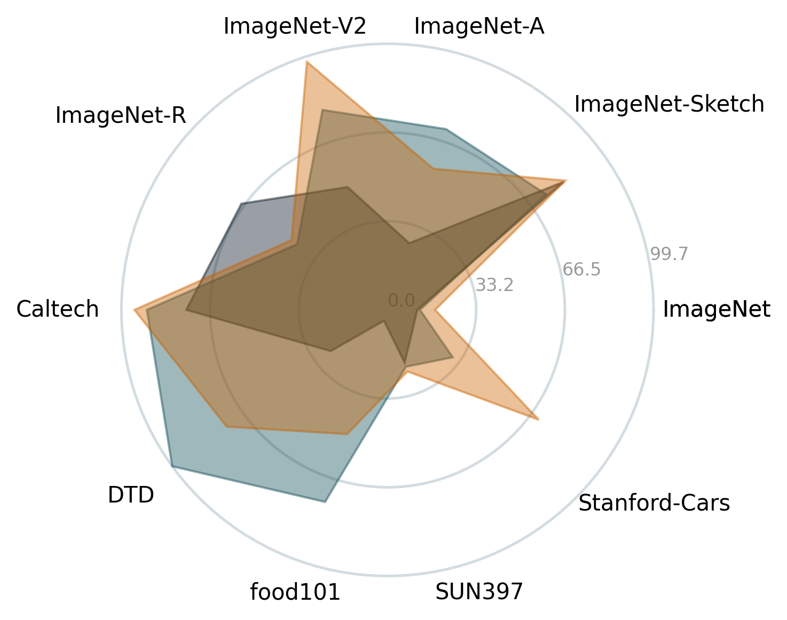
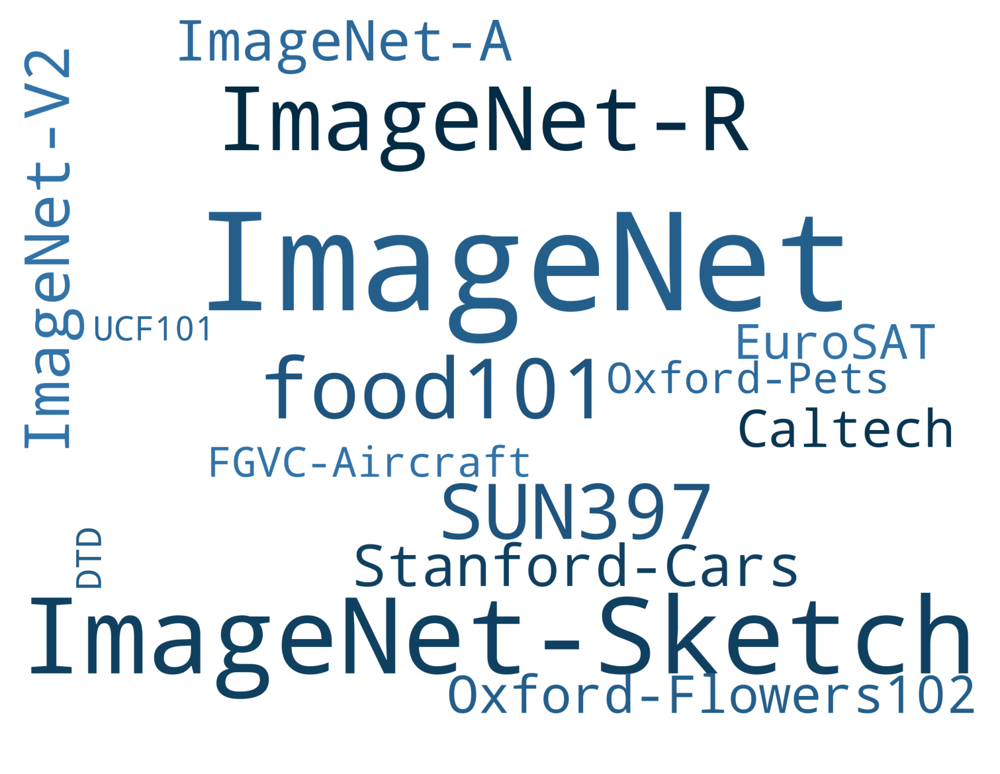
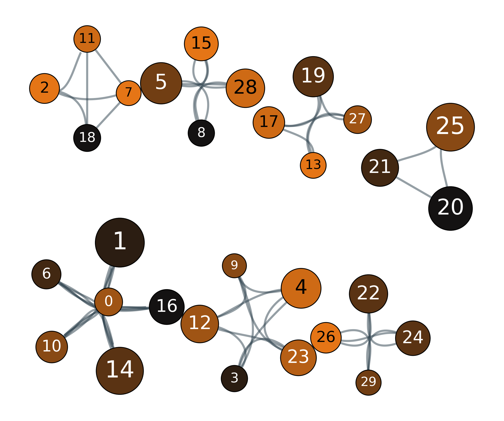
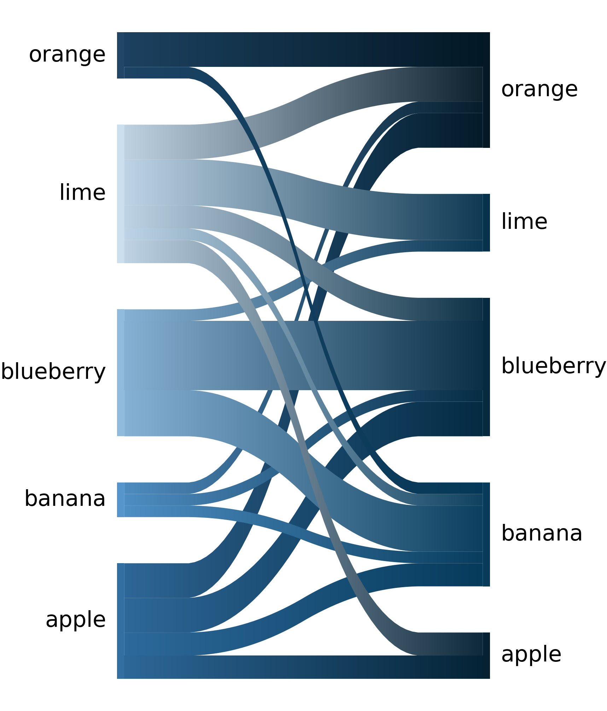

# Radar, word cloud, network and Sankey plots

These examples come from [`test_misc.py`](../test_misc.py). For options shared by
all plots, see [basics](basics.md).

| Plot | `plt_type` | Extra packages |
| --- | --- | --- |
| [Radar](#radar-plot) | `"radar"` | none |
| [Word cloud](#word-cloud) | `"word_cloud"` | `wordcloud` |
| [Network bubble](#network-bubble-plot) | `"network_bubble"` | `networkx`, `netgraph` |
| [Sankey](#sankey-plot) | `"sankey"` | none |

Run the examples with:

```bash
python test_misc.py
```

Most calls in `test_misc.py` are commented out so only the plot being worked on
is redrawn. Uncomment a call to regenerate its image.

## Radar plot

`plt_type="radar"` draws each curve as a filled shape around a circle. Each
spoke is one category, and distance from the center is the value. Three curves
is about the most that stays readable.

On a radar plot, the **x-axis** is the angle (the categories around the circle)
and the **y-axis** is the radius (the value rings).

### Setup

A radar plot needs a polar figure. Set both `subplot_kw` and
`polaroid_coordinates`:

```python
from ALL_PLOTS import ALL_PLOT
from colors_set import *
import torch

PLOT_FN = ALL_PLOT(
    subplot_kw={"projection": "polar"},   # polar figure
    polaroid_coordinates=True,            # polar-aware axis lines and label offsets

    figsize=(6, 4),
    colors=DISTINCT_3_2,
    artificial_darkening=0.8,

    grid_shape="xy",                      # spokes and rings
    grid_opacity=0.3,
    switch_off_xaxis=True,                # hide the outer circle
    switch_off_yaxis=True,                # no radial axis line
    X_label_fontsize=10,                  # category labels
    Y_label_fontsize=8,                   # ring value labels

    x_axis_label_dist_y=0.2,              # move category labels 0.2 inch outward
    x_axis_label_dist_x=0,                # no rotation
    y_axis_end_limit_offset=10,           # room beyond the outer ring
    y_axis_angle=10,                      # ring labels sit on the 10° spoke
)
```

### Fixed rings

Pass `Y_range` and `Y_labels` to choose the rings yourself:

```python
torch.manual_seed(100)
A, B, C = (torch.rand(10) * 100 for _ in range(3))

v_max = max(max(A), max(B), max(C))
Radar_label = ["ImageNet", "ImageNet-Sketch", "ImageNet-A", "ImageNet-V2",
               "ImageNet-R", "Caltech", "DTD", "food101", "SUN397", "Stanford-Cars"]

PLOT_FN.plot(plt_type="radar", name="Pictures/Misc/test_radar",
    Curves=[A, B, C],
    Alphas=[0.5, 0.5, 0.5],
    Curves_names=["Curve A", "Curve B", "Curve C"],
    Y_range=[50, v_max], Y_labels=["50", f"{v_max:.0f}"],
    X_labels=Radar_label,
    x_axis_label_dist_y=Radar_label_dist,   # per-label dict, see below
)
```

<p align="center">
  
</p>

### Automatic rings

Leave out `Y_range` and the rings are built from the data with `y_points` and
`decimal_places`, like any other plot. This needs `switch_off_yaxis=True`,
because the radial axis line is drawn up to `max(Y_range)`.

```python
PLOT_FN.plot(plt_type="radar", name="Pictures/Misc/test_radar_derive_ylabels",
    Curves=[A, B], Alphas=0.6,              # one opacity for every curve
    curve_line_opacity=1,
    X_labels=Radar_label, Curves_names=["Curve A", "Curve B"],
    x_axis_label_dist_y=Radar_label_dist,
    colors=DISTINCT_2_5,
    y_points=3, Y_label_opacity=0.4,        # 4 faint ring labels
    grid_shape="y", grid_opacity=0.5,       # rings only
    decimal_places=1,
    figsize=(5, 8),
)
```

<p align="center">
  
</p>

### Radar options

| Option | Default | What it does |
| --- | --- | --- |
| `Curves` | required | List of curves. Each is a list or 1-D tensor with one value per category. All curves need the same length. |
| `Curves_names` | required | One name per curve. Shown in the legend when `legend=True`. |
| `Alphas` | required | Fill opacity: one number for all curves, or one per curve, e.g. `[0.5, 0.5, 0.5]`. Use `0` for an outline only. |
| `colors` | orange, blue, pink | One color per curve. |
| `X_labels` | angles | One category name per value, in order counter-clockwise starting from the right. |
| `Y_range`, `Y_labels` | auto | Radii of the value rings and their text. Without them, rings come from `y_points`/`decimal_places`. |
| `curve_line_width` | `1` | Outline thickness. |
| `curve_line_opacity` | `1` | Outline opacity. |
| `y_axis_angle` | `10` | Angle in degrees of the spoke that carries the ring labels and the radial axis line. |
| `switch_off_yaxis` | `False` | Hide the radial axis line. Must be `True` when `Y_range` is not given. |
| `y_axis_width` | `1.2` | Thickness of the radial axis line. |
| `switch_off_xaxis` | `False` | Hide the outer circle. |
| `x_axis_width` | `1.2` | Thickness of the outer circle when it is shown. |
| `grid_shape` | `"both"` | `"x"` for spokes only, `"y"` for rings only, `"both"`/`"xy"` for both, `None` for neither. |

Pass `Y_labels=["", ""]` or `y_ticks_allowed=False` to hide the ring values.

### Positioning the category labels

On a radar plot, the x-label offsets work in circular terms:

| Option | Unit | Effect |
| --- | --- | --- |
| `x_axis_label_dist_x` | degrees | Rotates each label around the center. Positive is counter-clockwise. |
| `x_axis_label_dist_y` | inches | Moves each label away from the center. Negative moves it inward. |

Both take one number for all labels, or a dict to move single labels. Long
labels near the left and right usually need to move inward:

```python
Radar_label_dist = {
    "ImageNet": 0.12, "ImageNet-Sketch": 0.12,
    "ImageNet-A": -0.1, "ImageNet-V2": -0.1, "ImageNet-R": 0,
    "Caltech": 0.04, "DTD": -0.08, "food101": -0.1,
    "SUN397": -0.1, "Stanford-Cars": 0.1,
}
```

### Notes

- `X_labels` must have one entry per value in a curve.
- Curves passed as Python lists are extended in place to close the circle
  (the first value is appended). Pass tensors or copies if you reuse them.

## Word cloud

`plt_type="word_cloud"` draws words sized by a number such as a count or
frequency. You can also color each word by a second number. It needs the
`wordcloud` package.

```python
from ALL_PLOTS import ALL_PLOT
from colors_set import *
import numpy as np

PLOT_FN = ALL_PLOT(
    figsize=(6, 4),
    artificial_darkening=1,
    pad_inches=0.1,
)

names = ["ImageNet", "ImageNet-Sketch", "ImageNet-A", "ImageNet-V2", "ImageNet-R",
         "Caltech", "DTD", "food101", "SUN397", "Stanford-Cars", "FGVC-Aircraft",
         "Oxford-Pets", "Oxford-Flowers102", "EuroSAT", "UCF101"]
sizes = [50000, 50000, 7500, 10000, 30000, 6085, 1880, 25250, 19850, 8041,
         3333, 3669, 6149, 5000, 1794]
values = np.random.default_rng(seed=42).standard_normal(len(sizes)).tolist()

PLOT_FN.plot(plt_type="word_cloud", name="Pictures/Misc/test_word_cloud",
    Nodes=names, Sizes=sizes,
    Values=values,                    # colors each word by its value
    colors=DISTINCT_2_2,
    word_cloud_shape=(650, 850),
)
```

<p align="center">
  
</p>

### Word cloud options

| Option | Default | What it does |
| --- | --- | --- |
| `Nodes` | required | The words. |
| `Sizes` | required | One number per word. Bigger numbers give bigger words. |
| `Values` | `None` | One number per word, mapped onto the `colors` gradient (low values get the first color). Without it, the word cloud picks colors from the gradient itself. |
| `colors` | orange, blue, pink | Two or more colors, blended into a gradient. |
| `n_bins` | `10` | Number of color steps in the gradient. |
| `word_cloud_shape` | `(2000, 3500)` | Canvas `(height, width)` in pixels. Sets the shape of the cloud. |
| `scale_factor` | `3` | Rendering scale. Higher gives sharper words and slower rendering. |

Ticks, grid and axis lines are turned off for word clouds. Only the figure and
saving options from [basics](basics.md) apply.

## Network bubble plot

`plt_type="network_bubble"` draws labelled bubbles grouped into clusters, with
lines between them. Bubble size, bubble color and cluster come from three
separate numbers per node. It uses [`netgraph`](https://github.com/paulbrodersen/netgraph)
for the layout and needs `networkx` and `netgraph`.

```python
from ALL_PLOTS import ALL_PLOT
from colors_set import *
import torch

PLOT_FN = ALL_PLOT(
    figsize=(7, 7),
    colors=DISTINCT_2_1,                         # black -> orange
    artificial_darkening=0.8,
    node_size_formula=lambda x: (x ** 1.5) / 2,  # raw size -> bubble size
    node_edge_width=0.2,
    node_edge_color="black",
    node_labels_font_size=8,
    connect_edge_width=0.5,
    connect_edge_alpha=0.5,
    use_bunding=True,
    edges_with_cluster=True,
)

N_NODES = 30
Nodes  = torch.arange(N_NODES)          # node ids, also used as labels
Sizes  = torch.rand(N_NODES) * 1000     # bubble size
Scores = torch.rand(N_NODES)            # bubble color
Values = torch.rand(N_NODES)            # binned into clusters

PLOT_FN.plot(plt_type="network_bubble", name="Pictures/Misc/test_net_bubble",
    Nodes=Nodes, Sizes=Sizes, Scores=Scores,
    Values=Values,
    Labels=None,                        # None: cluster by binning Values
    n_cluster=7,
    node_size_range=(3, 6),
)
```

<p align="center">
  
</p>

The layout and the cross-cluster links are random, so every run looks
different.

### How the data is used

| Input | Becomes |
| --- | --- |
| `Nodes` | Node ids and the text inside each bubble. |
| `Sizes` | Bubble size: `node_size_formula(size)`, then rescaled into `node_size_range`. Label font size grows with the bubble. |
| `Scores` | Bubble color: the lowest score gets the first color of `colors`, the highest the last. |
| `Labels` | Cluster number per node, `0` to `n_cluster`. Nodes in the same cluster are placed together. |
| `Values` | Used only when `Labels` is `None`: split into `n_cluster` equal-width bins to make the clusters. |

`Sizes` and `Scores` can also be a single number, used for every node.

### Lines between bubbles

| `edges_with_cluster` | `use_bunding` | Lines drawn |
| --- | --- | --- |
| `True` | any | Every node joins every node in its own cluster. |
| `False` | `True` | Every node joins one random node from each other cluster. |
| `False` | `False` | Every node joins every other node. |

`use_bunding=True` also bundles lines that run in the same direction.

### Network options

| Option | Default | What it does |
| --- | --- | --- |
| `Nodes`, `Sizes`, `Scores` | required | See above. Lists, arrays or tensors. |
| `Labels` | `None` | Cluster per node. |
| `Values` | `None` | Binned into clusters when `Labels` is `None`. Without either, every node is in one cluster. |
| `n_cluster` | required | Number of clusters. |
| `colors` | orange, blue, pink | Two or more colors, blended into a gradient for `Scores`. |
| `n_bins` | `10` | Number of color steps in the gradient. |
| `node_size_formula` | `x -> x` | Function applied to each size before rescaling, e.g. `lambda x: x ** 1.5` to exaggerate differences. |
| `node_value_formula` | `x -> x` | Not used yet. |
| `node_size_range` | `(1, 6)` | Smallest and largest bubble, in hundredths of the plot width. |
| `node_alpha` | `1` | Bubble opacity. |
| `node_edge_width`, `node_edge_color` | `0.1`, `"black"` | Bubble outline. |
| `node_labels_font_size` | `10` | Base label size, scaled by bubble size. |
| `node_labels_colors` | `"white"` | Label color. |
| `color_contrast_ratio_threshold` | `4.5` | Labels switch to black when their contrast with the bubble is below this (4.5 is the WCAG AA level). |
| `edges_with_cluster`, `use_bunding` | `False`, `True` | Which lines to draw. See above. |
| `connect_edge_width`, `connect_edge_alpha` | `0.1`, `0.1` | Line thickness and opacity. |
| `scale_x`, `scale_y` | `1`, `1` | Stretch the layout horizontally or vertically. |

Ticks, grid and axis lines are not drawn. Only the figure and saving options
from [basics](basics.md) apply.

## Sankey plot

`plt_type="sankey"` draws flows from categories on the left to categories on
the right, for example true class to predicted class. Ribbon thickness is the
number (or total weight) of items making that move. Ribbons fade from the left
category's color to the right category's color.

The layout follows [pySankey](https://github.com/anazalea/pySankey), but it is
drawn on the `ALL_PLOT` axis, so pySankey is not needed.

```python
from ALL_PLOTS import ALL_PLOT
from colors_set import *
import numpy as np
import random

PLOT_FN = ALL_PLOT(
    figsize=(6, 7),
    pad_inches=0,
    gradient=True,
)

# One row per item: [left category, right category]
Relations = np.array([
    ["blueberry", "blueberry"],
    ["apple",     "blueberry"],
    ["lime",      "orange"],
    ["orange",    "banana"],
    # ... 40 rows in test_misc.py
])
Left, Right = Relations[:, 0], Relations[:, 1]

# One color per category: shades of blue on the left, shades of orange on the right
Color_Left  = [lighten_color(DISTINCT_2_8[1], amount=0.5 + 0.3 * i) for i, _ in enumerate(np.unique(Left))]
Color_Right = [lighten_color(DISTINCT_2_8[0], amount=0.5 + 0.2 * i) for i, _ in enumerate(np.unique(Right))]
random.shuffle(Color_Left)
random.shuffle(Color_Right)
left_axis_colors  = dict(zip(np.unique(Left),  Color_Left))
right_axis_colors = dict(zip(np.unique(Right), Color_Right))

PLOT_FN.plot(plt_type="sankey", name="Pictures/Misc/test_sankey",
    Left=Left, Right=Right,
    left_axis_colors=left_axis_colors,
    right_axis_colors=right_axis_colors,
    flow_width=1,
    node_gap=0.1,
    edges=False,
)
```

<p align="center">
  
</p>

Categories are sorted alphabetically from bottom to top on each side.

### Sankey options

| Option | Default | What it does |
| --- | --- | --- |
| `Left`, `Right` | required | Same-length lists or arrays. Item *i* flows from `Left[i]` to `Right[i]`. |
| `left_weights` | all `1` | Weight of each item on the left. Use it when each row is a count rather than one item. |
| `right_weights` | `left_weights` | Weight of each item on the right. |
| `left_axis_colors` | `BLUE` | One color for all left categories, or a dict of category → color. |
| `right_axis_colors` | `RED` | The same for the right side. |
| `gradient` | `True` | Fade each ribbon from its left color to its right color. `False` uses the left color only. |
| `opacity` | `1` | Ribbon opacity. |
| `flow_width` | `1` | Scales ribbon thickness. Below `1` leaves space between ribbons; `1` fills the category bars. |
| `node_gap` | `0.02` | Gap between category bars, as a fraction of the total weight. |
| `aspect` | `20` | Height-to-width ratio of the drawing. Lower values make it wider. |
| `labels_font_size` | `15` | Category label size. |
| `edges` | `True` | Outline each ribbon. |
| `edge_width`, `edgecolor`, `edge_alpha` | `1`, `"white"`, `0.6` | Ribbon outline thickness, color and opacity. |

The shared `colors` and `artificial_darkening` options do not apply. Set the
category colors with `left_axis_colors` and `right_axis_colors`. Ticks, grid
and axis lines are not drawn.
