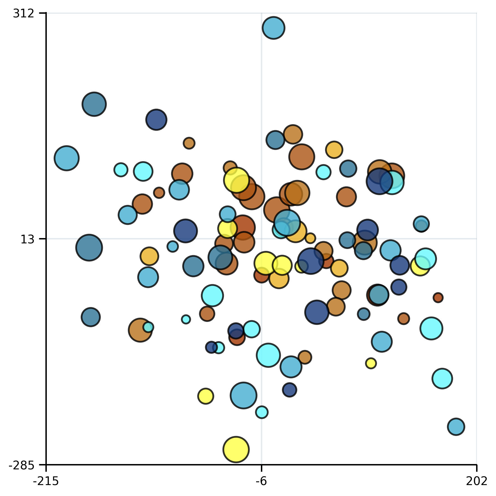
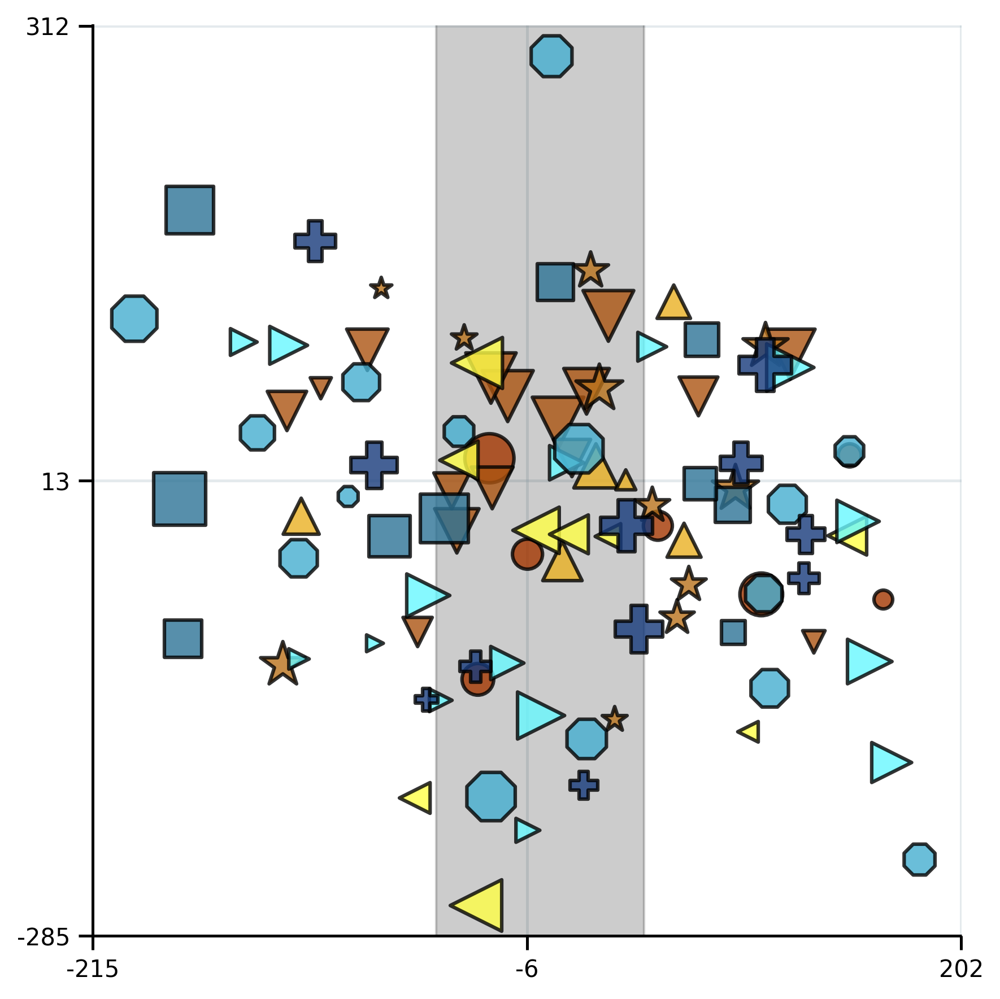
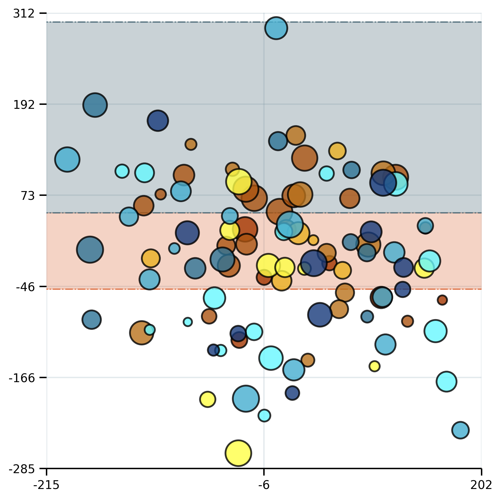

# Scatter plots

These examples correspond to [`test_scatter.py`](../test_scatter.py). Scatter
plots accept 2D points, group labels, and marker sizes.

## Basic grouped scatter plot

```python
from ALL_PLOTS import ALL_PLOT
from colors_set import ORANGE_LIGHTBLUE_10
import torch

Scatter_config = dict(
    scatter_boder_color="black",
    scatter_alpha=0.8,
)

PLOT_FN = ALL_PLOT(
    figsize=(6, 6),
    colors=ORANGE_LIGHTBLUE_10,
    decimal_places=0,
    y_up_offset=20,
    y_down_offset=20,
    x_up_offset=20,
    x_down_offset=20,
    Y_label_fontsize=10,
    X_label_fontsize=10,
    **Scatter_config,
)

N_POINTS = 100
POINTS = torch.randn(N_POINTS, 2) * 100
Labels = torch.randint(0, 9, (N_POINTS,))
SIZES = torch.randint(50, 500, (N_POINTS,))

PLOT_FN.plot(
    plt_type="scatter",
    name="Pictures/Scatter/test_scatter",
    Points=POINTS, Labels=Labels, Sizes=SIZES,
)
```

<p align="center">
  
</p>

This follows `test_scatter.py`: the coordinates, labels, and sizes are generated
with PyTorch, so the exact plot varies on each run. The nine integer labels are
colored from `ORANGE_LIGHTBLUE_10`, and each point receives an individual
marker size. Points are drawn from largest to smallest so smaller markers are
less likely to be hidden behind larger markers.

## Marker and label options

| Argument | Purpose |
| --- | --- |
| `Points` | Tensor or array of `[x, y]` coordinates |
| `Labels` | Group label for every point |
| `Sizes` | Single size or a size for every point |
| `Shapes` | String or list of marker shapes, keyed by label |
| `colors` | String, list, or label-to-color mapping |
| `scatter_boder` | Marker border width |
| `scatter_boder_color` | Marker border color |
| `scatter_alpha` | Marker transparency |
| `enable_relabeling` | Renumber labels for a compact label set |

## Marker shapes

Pass a shape dictionary to give each label its own marker:

```python
SHAPE = {
    0: "o", 1: "v", 2: "*", 3: "^", 4: "<",
    5: ">", 6: "8", 7: "s", 8: "P",
}

PLOT_FN.plot(
    plt_type="scatter",
    name="Pictures/Scatter/test_scatter_shape",
    Points=POINTS,
    Labels=Labels,
    Sizes=SIZES,
    Shapes=SHAPE,
)
```

<p align="center">
  
</p>

## Scatter plot with shaded regions

[`plot_add.py`](../plot_add.py) annotations can be combined with scatter plots.
This shaded example follows `test_scatter.py`:

```python
from colors_set import DISTINCT_2_8

UPDATE = dict(
    switch_off_yaxis=True,
    y_points=5,
)
PLOT_FN.update_params(UPDATE)

PLOT_FN.plot(
    plt_type="scatter",
    name="Pictures/Scatter/test_scatter_shade",
    Points=POINTS,
    Labels=Labels,
    Sizes=SIZES,
    h_line_shade=[[-50, 50], [50, 300]],
    h_line_shade_color=DISTINCT_2_8,
    h_line_shade_color_alpha=0.3,
    line_width=1,
    vline_offset=50, hline_offset=50,
)
```

<p align="center">
  
</p>

The same annotation arguments used in [`line.md`](line.md) are available:

- `h_lines` and `v_lines` draw guide lines.
- `h_line_shade` draws horizontal shaded bands.
- `v_line_shade` draws vertical shaded bands.
- `hline_offset` and `vline_offset` extend guide ranges beyond the data.

## Colors

Named colors and palette sets are available in
[`colors_set.py`](../colors_set.py).

```python
from colors_set import DISTINCT_3_6

plotter = ALL_PLOT(
    colors=DISTINCT_3_6,
    artificial_darkening=0.8,
)
```

The scatter helper accepts the following color forms:

| Color input | Behavior |
| --- | --- |
| `colors="blue"` | Apply one color to every label |
| `colors=[BLUE, ORANGE, RED]` | Assign colors to labels in sorted order |
| `colors={"category": "#hex", ...}` | Assign explicit colors to label values |
